## CS6910: Fundamentals of Deep Learning

Lecture 2: McCulloch Pitts Neuron, Thresholding Logic, Perceptrons, Perceptron Learning Algorithm and Convergence, Multilayer Perceptrons (MLPs), Representation Power of MLPs

## Mitesh M. Khapra

## Module 2.1: Biological Neurons

## Mitesh M. Khapra

y

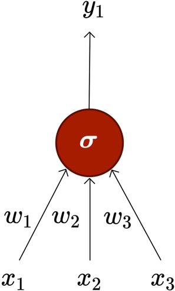

Artificial
Neuron
The most fundamental unit of a deep neural network is called an artificial neuron
Why is it called a neuron ? Where does the inspiration come from ?
The inspiration comes from biology (more specifically, from the brain)
biological neurons = neural cells = neural processing units
We will first see what a biological neuron looks like
in.
oma

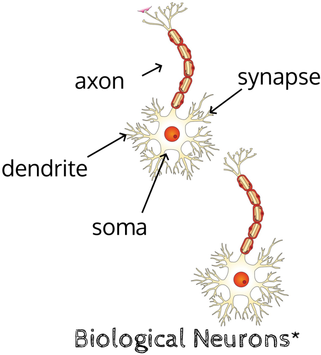

dendrite: receives signals from other neurons
synapse: point of connection to other neurons
soma: processes the information
axon: transmits the output of this neuron
HA - HA!
DON'T YOU THINK THAT IF I WERE WRONG,
R
OTFL

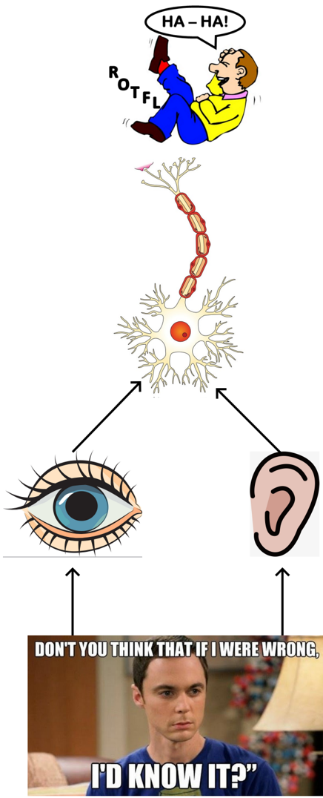

Let us see a very cartoonish illustration of how a neuron works
Our sense organs interact with the outside world
They relay information to the neurons
The neurons (may) get activated and produces a response (laughter in this case)

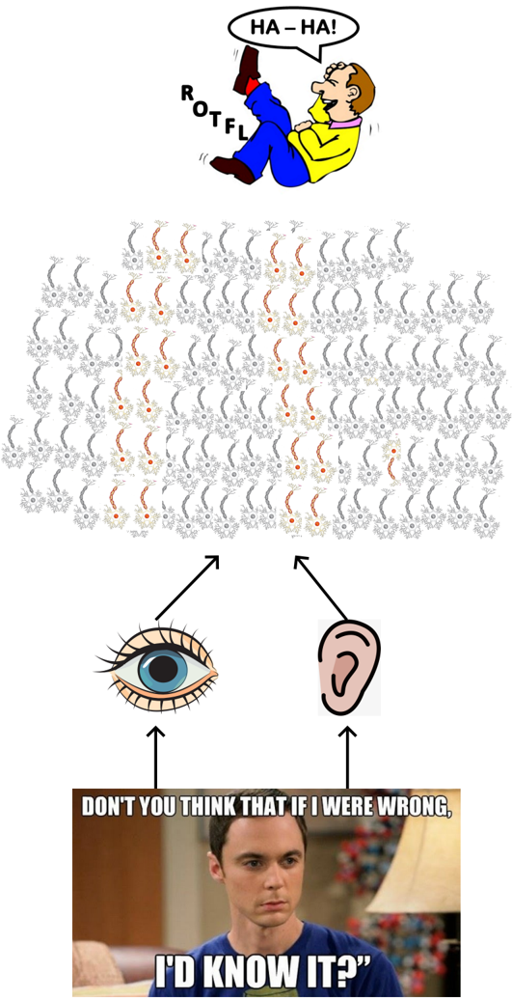

Of course, in reality, it is not just a single neuron which does all this
There is a massively parallel interconnected network of neurons
The sense organs relay information to the lowest layer of neurons
Some of these neurons may fire (in red) in response to this information and in turn relay information to other neurons they are connected to
These neurons may also fire (again, in red) and the process continues eventually resulting in a response (laughter in this case)
An average human brain has around (100 billion) neurons! 10 11

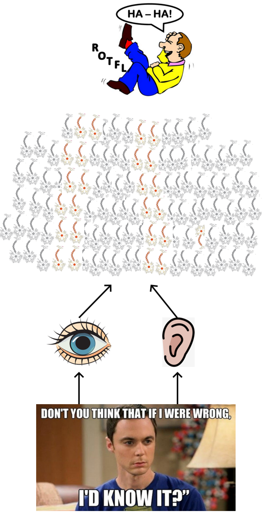

This massively parallel network also ensures that there is division of work
Each neuron may perform a certain role or respond to a certain stimulus
fires if at least 2 of 3 inputs fired

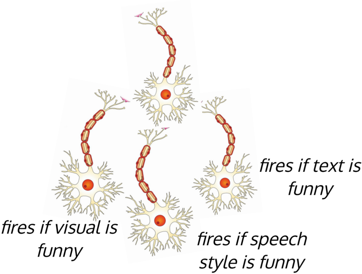

A simplified illustration
This massively parallel network also ensures that there is division of work
Each neuron may perform a certain role or respond to a certain stimulus
Categorical judgments, decision making
120-160 ms
100-130 ms
PFC
140-190 ms
PMC
Simple visual forms edges, corners
-

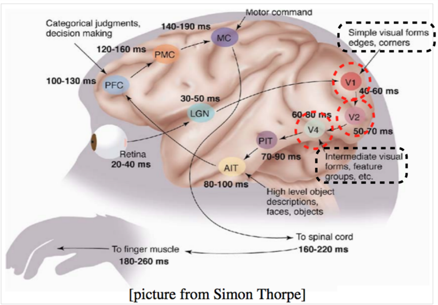

MC
Motor command
V1
The neurons in the brain are arranged in a hierarchy
We illustrate this with the help of visual cortex (part of the brain) which deals with processing visual information
Starting from the retina, the information is relayed to several layers (follow the arrows)
We observe that the layers V1, V2 to AIT form a hierarchy (from identifying simple visual forms to high level objects)
Categorical judgments, decision making
120-160 ms
100-130 ms
140-190 ms
PMC
Simple visual forms edges, corners
-

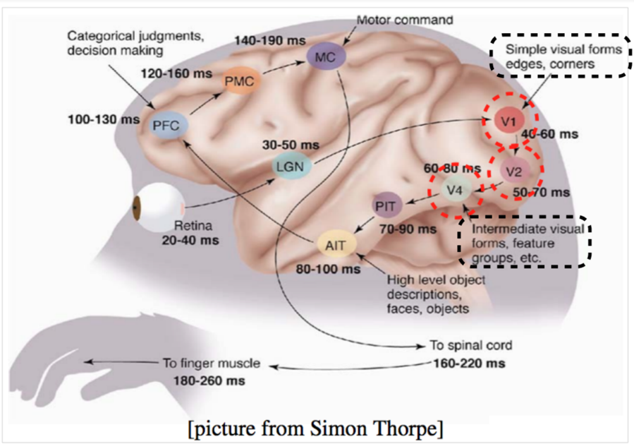

MC
Motor command
V1

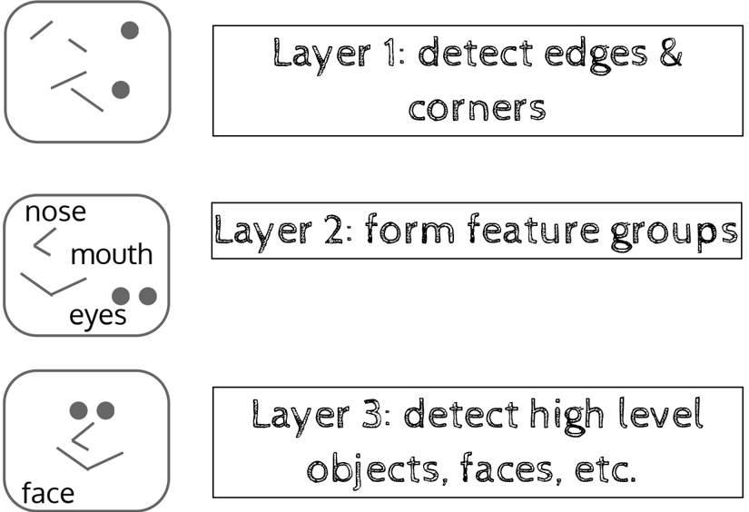

Sample illustration of hierarchical processing*
________________________________________
*Idea  borrowed  from  Hugo  Larochelle's  lecture slides

## Disclaimer

I understand very little about how the brain works!
What you saw so far is an overly simplified explanation of how the brain works!
But this explanation suffices for the purpose of this course!

## Module 2.2: McCulloch Pitts Neuron

## Mitesh M. Khapra

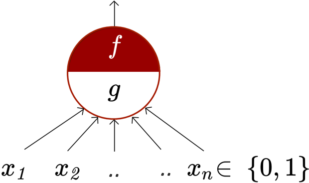

This is called the Thresholding Logic
McCulloch (neuroscientist) and Pitts (logician) a highly simplified computational model of the neuron (1943) proposed aggregates the inputs and the function takes a decision based on this aggregation g f
The inputs can be excitatory or inhibitory

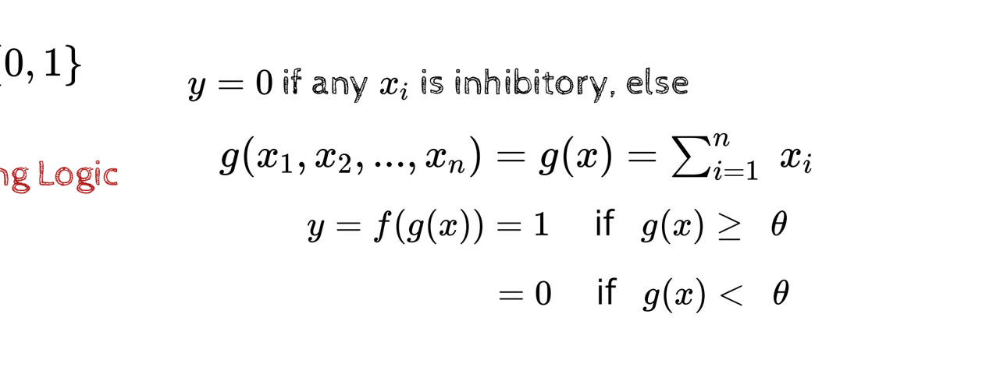

is called the thresholding parameter θ

## Let us implement some boolean functions using this McCulloch Pitts (MP) neuron ...

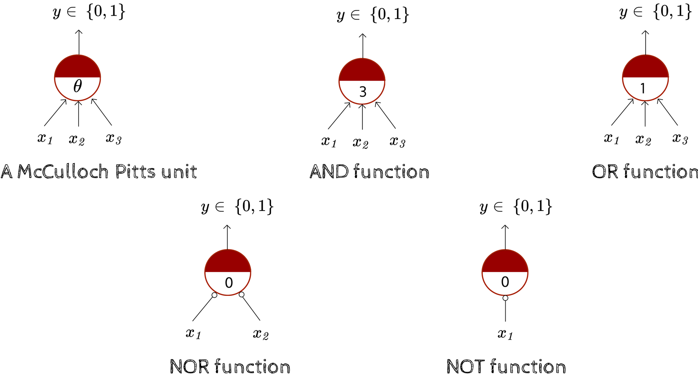

* circle at the end indicates inhibitory input: if any inhibitory input is 1 the output will be 0
Can any boolean function be represented using a McCulloch Pitts unit?
Before answering this question let us first see the geometric interpretation of a MP unit...

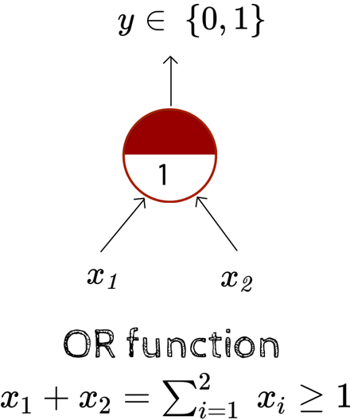

https://www.geogebra.org/material/if rame/id/mahjpakn/width/700/height/ 500/border/888888/sfsb/true/smb/f alse/stb/false/stbh/false/ai/false/asb /false/sri/false/rc/false/ld/false/sdz/t rue/ctl/false
A single MP neuron splits the input points (4 points for 2 binary inputs) into two halves
Points lying on or above the line and points lying below this line x -∑ i =1 n i θ = 0
In other words, all inputs which produce an output 0 will be on one side ) of the line and all inputs which produce an output 1 will lie on the other side ) of this line ( x < ∑ i =1 n i θ ( x ≥ ∑ i =1 n i θ
Let us convince ourselves about this with a few more examples (if it is not already clear from the math)

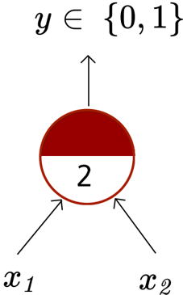

## AND function

https://www.geogebra.org/material/if rame/id/rfauaj8s/width/700/height/5 00/border/888888/sfsb/true/smb/fal se/stb/false/stbh/false/ai/false/asb/f alse/sri/false/rc/false/ld/false/sdz/tru e/ctl/false

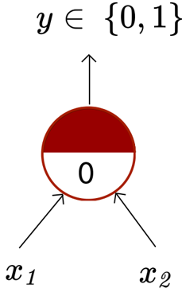

Tautology (always ON)
https://www.geogebra.org/material/if rame/id/e7km2mev/width/700/height /500/border/888888/sfsb/true/smb/f alse/stb/false/stbh/false/ai/false/asb /false/sri/false/rc/false/ld/false/sdz/t rue/ctl/false

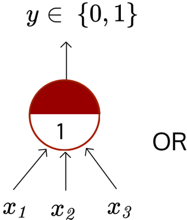

https://www.geogebra.org/material/iframe/i d/qekt8th2/width/700/height/500/border/8 88888/sfsb/true/smb/false/stb/false/stbh/f alse/ai/false/asb/false/sri/false/rc/false/ld/f alse/sdz/true/ctl/false
What if we have more than 2 inputs?
Well, instead of a line we will have a plane
For the OR function, we want a plane such that the point (0,0,0) lies on one side and the remaining 7 points lie on the other side of the plane

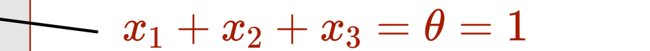

## The story so far ...

A single McCulloch Pitts Neuron can be used to represent boolean functions which are linearly separable
Linear separability (for boolean functions) : There exists a line (plane) such that all inputs which produce a 1 lie on one side of the line (plane) and all inputs which produce a 0 lie on other side of the line (plane)

## Module 2.3: Perceptron

## Mitesh M. Khapra

## The story ahead ...

What about non-boolean (say, real) inputs ?
Do we always need to hand code the threshold ?
Are all inputs equal ? What if we want to assign more weight (importance) to some inputs ?
What about functions which are not linearly separable ?
y

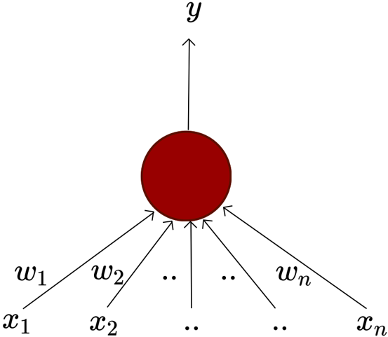

Frank Rosenblatt, an American psychologist, proposed the classical perceptron model (1958)
A more general computational model than McCulloch-Pitts neurons
Main differences: Introduction of numerical weights for inputs and a mechanism for learning these weights
Inputs are no longer limited to boolean values
Refined and carefully analyzed by Minsky and Papert (1969) - their model is referred to as the perceptron model here
y

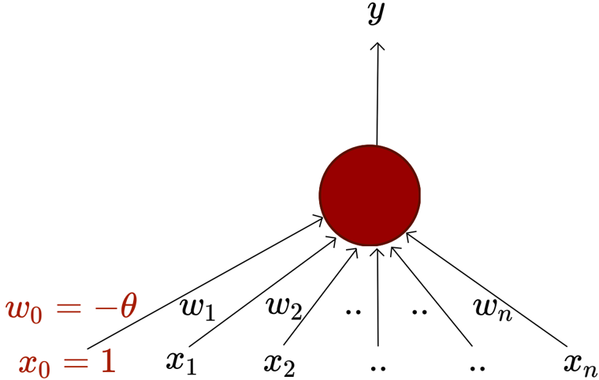

A more accepted convention,

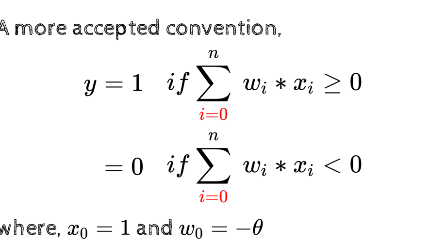

where, and x 0 = 1 w 0 = θ

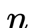

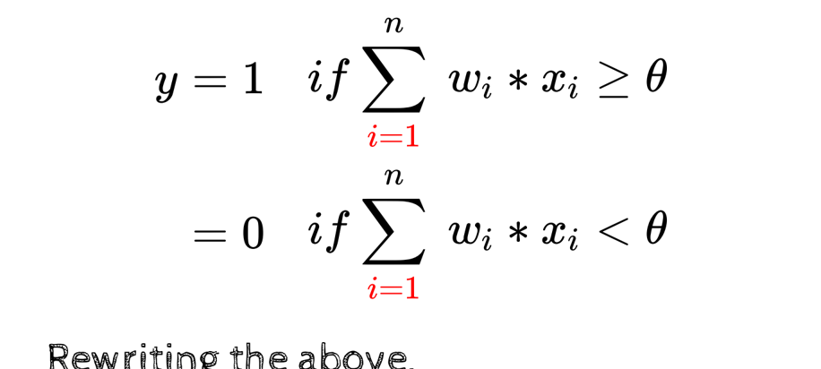

Rewriting the above,

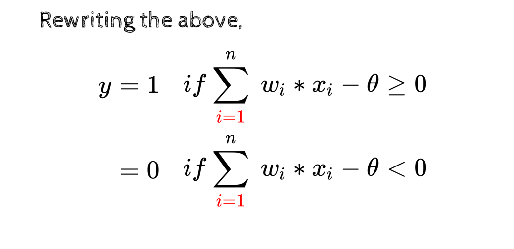

## We will now try to answer the following questions:

Why are we trying to implement boolean functions? Why do we need weights ? Why is called the bias ? w 0 = θ
y

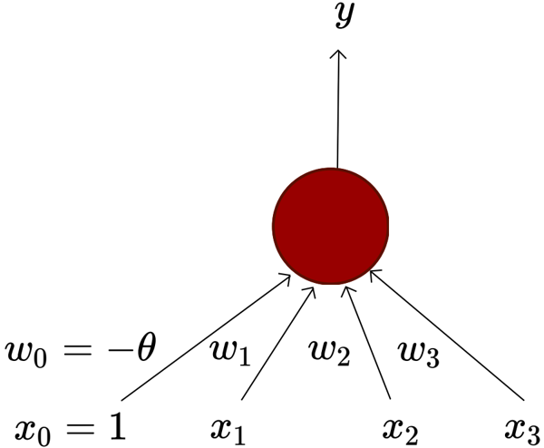

x 1 = isActorDamon
x 2 = isGenreThriller
x 3 = isDirectorNolan
Consider the task of predicting whether we would like a movie or not
Suppose, we base our decision on 3 inputs (binary, for simplicity)
Based on our past viewing experience (data), we may give a high weight to isDirectorNolan as compared to the other inputs
Specifically, even if the actor is not Matt Damon and the genre is not thriller we would still want to cross the threshold by assigning a high weight to isDirectorNolan θ
y

x 1 = isActorDamon x 2 = isGenreThriller
x 3 = isDirectorNolan is called the bias as it represents the prior (prejudice) w 0
A movie buff may have a very low threshold and may watch any movie irrespective of the genre, actor, director [ θ = 0]
On the other hand, a selective viewer may only watch thrillers starring Matt Damon and directed by Nolan [ θ = 3]
The weights and the the bias will depend on the data (viewer history in this case) ( w , w , ..., w ) 1 2 n ( w 0 )
What  kind  of  functions  can  be  implemented  using  the  perceptron?  Any difference from McCulloch Pitts neurons?

## McCulloch Pitts Neuron

(assuming no inhibitory inputs)

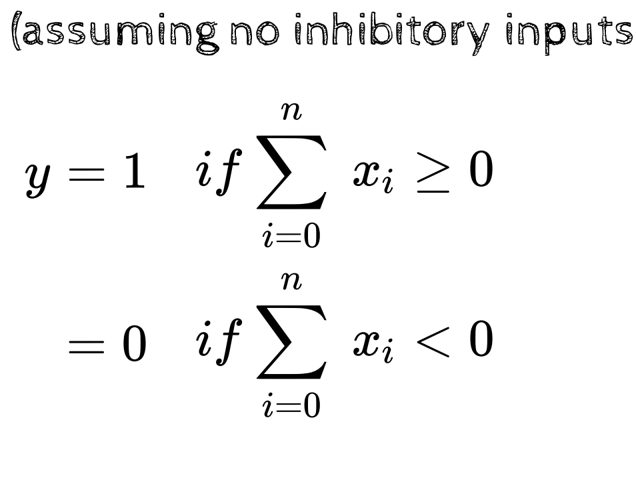

## Perceptron

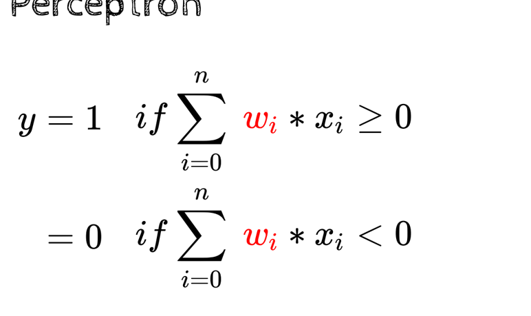

From the equations it should be clear that even a perceptron separates the input space into two halves
All inputs which produce a 1 lie on one side and all inputs which produce a 0 lie on the other side
In other words, a single perceptron can only be used to implement linearly separable functions
Then what is the difference?
The weights (including threshold) can be learned and the inputs can be real valued
We will first revisit some boolean functions and then see the perceptron learning algorithm (for learning weights)

|   x 1 |   x 2 | OR                           |
|-------|-------|------------------------------|
|     0 |     0 | 0 w + 0 w x < ∑ i =1 2 i i 0 |
|     1 |     0 | 1 w + 0 w x ≥ ∑ i =1 2 i i 0 |
|     0 |     1 | 1 w + 0 w x ≥ ∑ i =1 2 i i 0 |
|     1 |     1 | 1 w + 0 w x ≥ ∑ i =1 2 i i 0 |

> 📊 [Table 1 CSV](artifacts/tables/table_1.csv) | [Table 1 HTML](artifacts/tables/table_1.html)

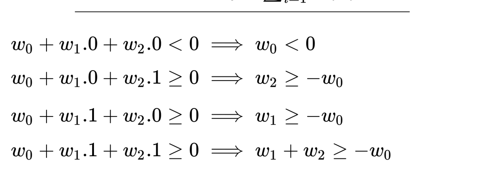

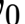

One possible solution to this set of inequalities is , , (and various other solutions are possible) w 0 = -1 w 1 = 1.1 w 2 = 1.1
https://www.geogebra.org/material/iframe/id/q mfv6zdb/width/700/height/500/border/888888 /sfsb/true/smb/false/stb/false/stbh/false/ai/fal se/asb/false/sri/false/rc/false/ld/false/sdz/true/ ctl/false
Note that we can come up with a similar set of inequalities and find the value of for a McCulloch Pitts neuron also (Try it!) θ

## Module 2.4: Errors and Error Surfaces

## Mitesh M. Khapra

Let us fix the threshold ( ) and try different values of , w 0 = -1 w 1 w 2

- What is wrong with this line?
Let's try some more values of , and note how many errors we make w 1 w 2 We make an error on 1 out of the 4 inputs

|   w 1 |   w 2 |   errors |
|-------|-------|----------|
|  -1   |    -1 |        1 |
|   1.5 |     0 |        1 |
|  10   |   -10 |        2 |

> 📊 [Table 2 CSV](artifacts/tables/table_2.csv) | [Table 2 HTML](artifacts/tables/table_2.html)

We are interested in those values of , , which result in 0 error w 0 w 1 w 2
- Let us plot the error surface corresponding to different values of , , w 0 w 1 w 2
https://www.geogebra.org/material/iframe/id/bdqps9su /width/700/height/500/border/888888/sfsb/true/smb/f alse/stb/false/stbh/false/ai/false/asb/false/sri/false/rc/ false/ld/false/sdz/true/ctl/false
https://arunprakasha.github.io/plotly/or_errorSurface.html
For ease of analysis, we will keep fixed (-1) and plot the error for different values of , w 0 w 1 w 2
For a given , , we will compute for all combinations of ( ) and note down how many errors we make w 0 w 1 w 2 -w 0 + w 1 ∗ x 1 + w 2 ∗ x 2 x , x 1 2
For the OR function, an error occurs if ( ) = ( ) but or if ( ) ( ) but x , x 1 2 0, 0 -w 0 + w 1 ∗ x 1 + w 2 ∗ x 2 ≥ 0 x , x 1 2 =  0,0 -w 0 + w 1 ∗ x 1 + w 2 ∗ x 2 < 0
We are interested in finding an algorithm which finds the values of , which minimize this error w 1 w 2

## Module 2.5: Perceptron Learning Algorithm

## Mitesh M. Khapra

We will now see a more principled approach for learning these weights and threshold but before that let us answer this question...
Apart from implementing boolean functions (which does not look very interesting) what can a perceptron be used for ?
Our interest lies in the use of perceptron as a binary classifier. Let us see what this means...
y

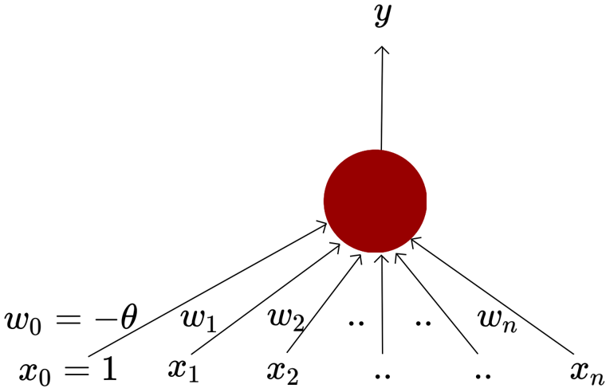

x 1 = isActorDamon x 2 = isGenreThriller
x 3 = isDirectorNolan x 4 = imdbRating (scaled to 0 to 1)
...
...
xn = criticsRating (scaled to 0 to 1)
Let us reconsider our problem of deciding whether to watch a movie or not
Suppose we are given a list of movies and a label (class) associated with each movie indicating whether the user liked this movie or not : binary decision m
Further, suppose we represent each movie with features (some boolean, some real valued) n
We will assume that the data is linearly separable and we want a perceptron to learn how to make this decision
In other words, we want the perceptron to find the equation of this separating plane (or find the values of ) w , w , w , ..., w 0 1 2 m

## Algorithm: Perceptron Learning Algorithm

; P ← inputs with label 1 ; N ← inputs with label 0 Initialize randomly; w while do ! convergence Pick random ; x ∈ P ∪ N = ; w w + x end end //the algorithm converges when all the inputs are classified correctly if then x ∈ P and w ∗ ∑ i =0 n i x < i 0 end if then x ∈ N and w ∗ ∑ i =0 n i x ≥ i 0 = ; w w -x
Why would this work ?
To understand why this works we will have to get into a bit of Linear Algebra and a bit of geometry...

## Consider two vectors and w x

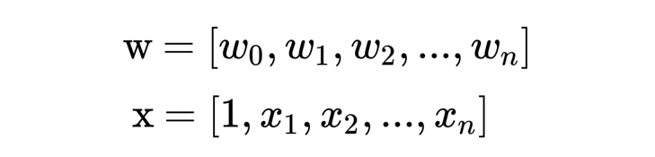

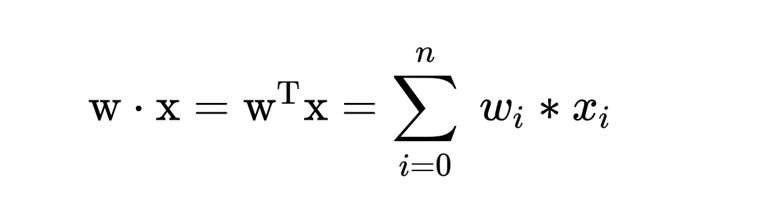

We can thus rewrite the perceptron rule as

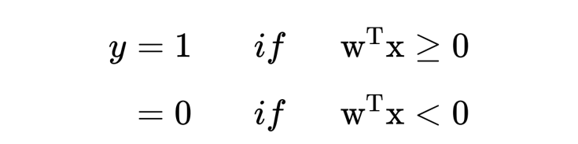

We are interested in finding the line which divides the input space into two halves w x = T 0
Every point ( ) on this line satisfies the equation x w x = T 0
What can you tell about the angle ( ) between and any point ( ) which lies on this line ? α w x

Since the vector is perpendicular to every point on the line it is actually perpendicular to the line itself w
Consider some points (vectors) which lie in the positive half space of this line (i.e., ) w x > T 0
What will be the angle between any such vector and ? w Obviously, less than 90 ∘
What about points (vectors) which lie in the negative half space of this line (i.e., ) w x < T 0
What will be the angle between any such vector and ? w Obviously, greater than 90 ∘
Of course, this also follows from the formula ( = ) cosα ∥ w ∥∥ x ∥ w x T

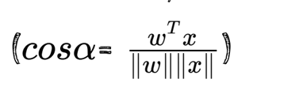

Keeping this picture in mind let us revisit the algorithm

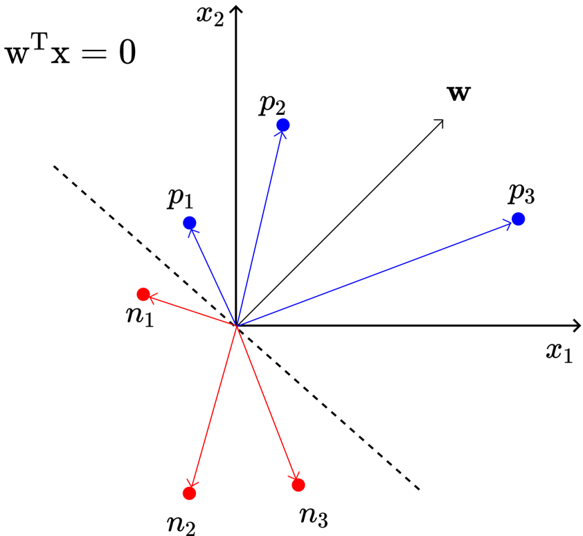

## Algorithm: Perceptron Learning Algorithm

; P ← inputs with label 1 ; N ← inputs with label 0 Initialize randomly; w while do ! convergence Pick random ; x ∈ P ∪ N = ; w w + x end end //the algorithm converges when all the inputs are classified correctly if then x ∈ P and w ∗ ∑ i =0 n i x < i 0 end if then x ∈ N and w ∗ ∑ i =0 n i x ≥ i 0 = ; w w -x
For if then it means that the angle ( ) between this and the current is greater than x ∈ P w x < T 0 α x w 90 ∘ ) 90 ∘
What happens to the new angle ( ) when α new w new = w+x
( ) ( cos α new ∝ w ) x new T ∝ (w + x) T x ∝ w x + T x T x ∝ cosα +x x T (but we want to be less than

Thus will be less than and this is exactly what we want α new α

## Algorithm: Perceptron Learning Algorithm

; P ← inputs with label 1 ; N ← inputs with label 0 Initialize randomly; w while do ! convergence Pick random ; x ∈ P ∪ N = ; w w + x end end //the algorithm converges when all the inputs are classified correctly if then x ∈ P and w ∗ ∑ i =0 n i x < i 0 end if then x ∈ N and w ∗ ∑ i =0 n i x ≥ i 0 = ; w w -x
For if then it means that the angle ( ) between this and the current is less than x ∈ N w x ≥ T 0 α x w 90 ∘ What happens to the new angle ( ) when α new w new = w-x ( ) ( cos α new ∝ w ) + new T x ∝ (w - x) T x ∝ w x T x T x ∝ cosα -x x T (but we want to be greater than ) 90 ∘

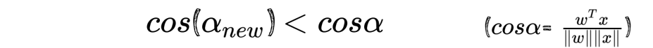

Thus will be greater than and this is exactly what we want α new α
We will now see this algorithm in action for a toy dataset

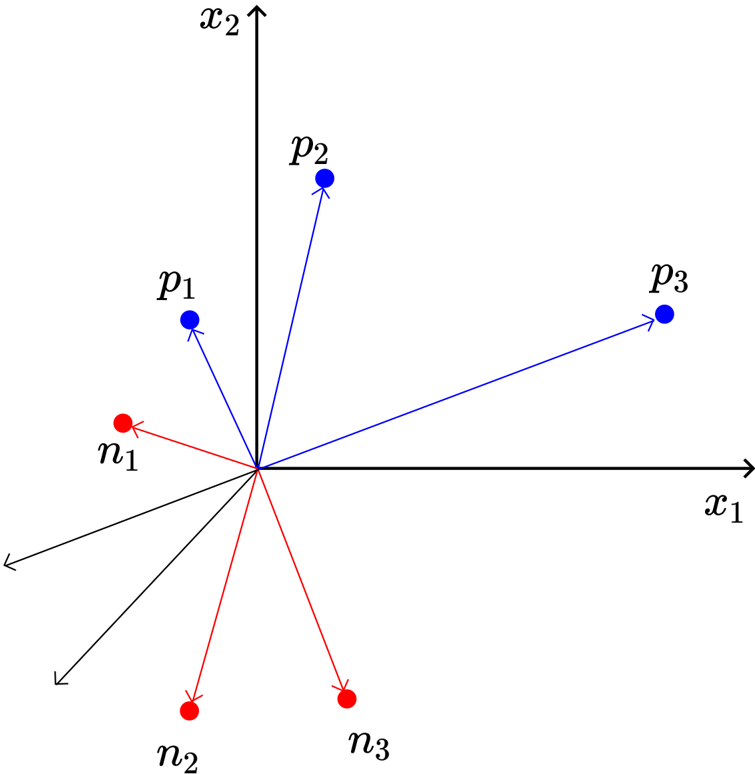

We initialized to a random value
w
We observe that currently, ( angle for all the positive points and ( angle for all the negative points (the situation is exactly opposite of what we actually want it to be) w⋅ x < 0 ∵ α > 90 ∘ w⋅ x ≥ 0 ∵ α < 90 ∘
We now run the algorithm by randomly going over the points
Randomly pick a point (say, ), apply correction ( ) (you can check the angle visually) p 1 w = w + x ∵ w⋅ x < 0

We initialized to a random value
w
We observe that currently, ( angle for all the positive points and ( angle for all the negative points (the situation is exactly opposite of what we actually want it to be) w⋅ x < 0 ∵ α > 90 ∘ w⋅ x ≥ 0 ∵ α < 90 ∘
We now run the algorithm by randomly going over the points
Randomly pick a point (say, ), apply correction ( ) (you can check the angle visually) p 2 w = w + x ∵ w⋅ x < 0

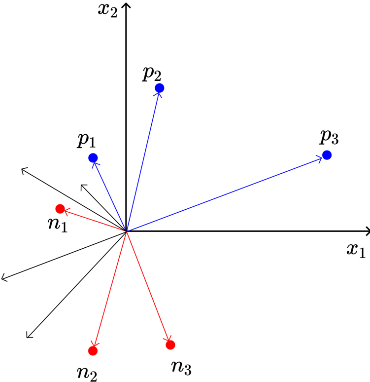

We initialized to a random value
w
We observe that currently, ( angle for all the positive points and ( angle for all the negative points (the situation is exactly opposite of what we actually want it to be) w⋅ x < 0 ∵ α > 90 ∘ w⋅ x ≥ 0 ∵ α < 90 ∘
We now run the algorithm by randomly going over the points
Randomly pick a point (say, ), apply correction ( ) (you can check the angle visually) n 1 w = w - x ∵ w⋅ x ≥ 0

We initialized to a random value
w
We observe that currently, ( angle for all the positive points and ( angle for all the negative points (the situation is exactly opposite of what we actually want it to be) w⋅ x < 0 ∵ α > 90 ∘ w⋅ x ≥ 0 ∵ α < 90 ∘
We now run the algorithm by randomly going over the points
Randomly pick a point (say, ), no correction needed (you can check the angle visually) n 3 ∵ w ⋅ x < 0

We initialized to a random value
w
We observe that currently, ( angle for all the positive points and ( angle for all the negative points (the situation is exactly opposite of what we actually want it to be) w⋅ x < 0 ∵ α > 90 ∘ w⋅ x ≥ 0 ∵ α < 90 ∘
We now run the algorithm by randomly going over the points
Randomly pick a point (say, ), no correction needed (you can check the angle visually) n 2 ∵ w ⋅ x < 0

We initialized to a random value
w
We observe that currently, ( angle for all the positive points and ( angle for all the negative points (the situation is exactly opposite of what we actually want it to be) w⋅ x < 0 ∵ α > 90 ∘ w⋅ x ≥ 0 ∵ α < 90 ∘
We now run the algorithm by randomly going over the points
Randomly pick a point (say, ), apply correction ( ) (you can check the angle visually) p 3 w = w + x ∵ w⋅ x < 0

We initialized to a random value
w
We observe that currently, ( angle for all the positive points and ( angle for all the negative points (the situation is exactly opposite of what we actually want it to be) w⋅ x < 0 ∵ α > 90 ∘ w⋅ x ≥ 0 ∵ α < 90 ∘
We now run the algorithm by randomly going over the points
Randomly pick a point (say, ), no correction needed (you can check the angle visually) p 1 ∵ w ⋅ x ≥ 0

We initialized to a random value
w
We observe that currently, ( angle for all the positive points and ( angle for all the negative points (the situation is exactly opposite of what we actually want it to be) w⋅ x < 0 ∵ α > 90 ∘ w⋅ x ≥ 0 ∵ α < 90 ∘
We now run the algorithm by randomly going over the points
Randomly pick a point (say, ), no correction needed (you can check the angle visually) p 2 ∵ w ⋅ x ≥ 0

We initialized to a random value
w
We observe that currently, ( angle for all the positive points and ( angle for all the negative points (the situation is exactly opposite of what we actually want it to be) w⋅ x < 0 ∵ α > 90 ∘ w⋅ x ≥ 0 ∵ α < 90 ∘
We now run the algorithm by randomly going over the points
Randomly pick a point (say, ), no correction needed (you can check the angle visually) n 1 ∵ w ⋅ x < 0

We initialized to a random value
w
We observe that currently, ( angle for all the positive points and ( angle for all the negative points (the situation is exactly opposite of what we actually want it to be) w⋅ x < 0 ∵ α > 90 ∘ w⋅ x ≥ 0 ∵ α < 90 ∘
We now run the algorithm by randomly going over the points
Randomly pick a point (say, ), no correction needed (you can check the angle visually) n 3 ∵ w ⋅ x < 0

We initialized to a random value
w
We observe that currently, ( angle for all the positive points and ( angle for all the negative points (the situation is exactly opposite of what we actually want it to be) w⋅ x < 0 ∵ α > 90 ∘ w⋅ x ≥ 0 ∵ α < 90 ∘
We now run the algorithm by randomly going over the points
Randomly pick a point (say, ), no correction needed (you can check the angle visually) n 2 ∵ w ⋅ x < 0

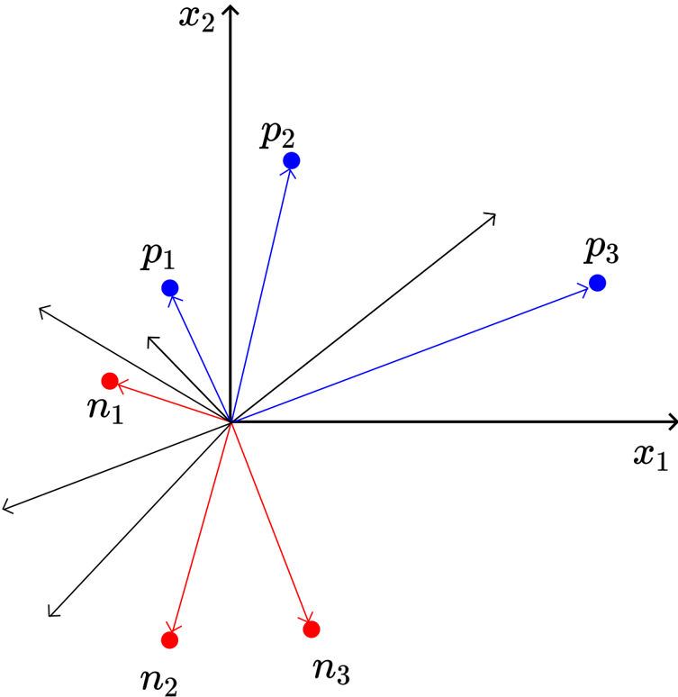

We initialized to a random value
w
We observe that currently, ( angle for all the positive points and ( angle for all the negative points (the situation is exactly opposite of what we actually want it to be) w⋅ x < 0 ∵ α > 90 ∘ w⋅ x ≥ 0 ∵ α < 90 ∘
We now run the algorithm by randomly going over the points
Randomly pick a point (say, ), no correction needed (you can check the angle visually) p 3 ∵ w ⋅ x ≥ 0

We initialized to a random value
w
We observe that currently, ( angle for all the positive points and ( angle for all the negative points (the situation is exactly opposite of what we actually want it to be) w⋅ x < 0 ∵ α > 90 ∘ w⋅ x ≥ 0 ∵ α < 90 ∘
We now run the algorithm by randomly going over the points
The algorithm has converged

## Module 2.6: Proof of Convergence

## Mitesh M. Khapra

Now that we have some faith and intuition about why the algorithm works, we will see a more formal proof of convergence ...

## Theorem

Definition: Two sets and of points in an -dimensional space are called absolutely linearly separable if real numbers exist such that every point ( satisfies and every point satisfies . P N n n +1 w , w , ..., w 0 1 n x , x , ..., x ) ∈ 1 2 n P w ∗ ∑ i =1 n i x > i 0 ( x , x , ..., x ) ∈ 1 2 n N w ∗ ∑ i =1 n i x < i w 0 real numbers exist n +1 w , w , ..., w 0 1 n and    every   point satisfies . ( x , x , ..., x ) ∈ 1 2 n N w ∗ ∑ i =1 n i x < i w 0 such that every point ( satisfies x , x , ..., x ) ∈ 1 2 n P w ∗ ∑ i =1 n i x ≥ i w 0
Proposition: If the sets and are finite and linearly separable, the perceptron learning algorithm updates the weight vector a finite number of times. In other words: if the vectors in and are tested cyclically one after the other, a weight vector is found after a finite number of steps   which can separate the two sets. P N wt P N wt t the perceptron learning algorithm updates the weight vector a finite number of times. In other words: if the vectors in and are tested cyclically one after the other, a weight vector is found after a finite number of steps   which can separate the two sets. w P N wt t In other words: if the vectors in and are tested cyclically one after the other, P N a weight vector is found after a finite number of steps   which can separate the two sets. w t
Proof: On the next slide

## Setup

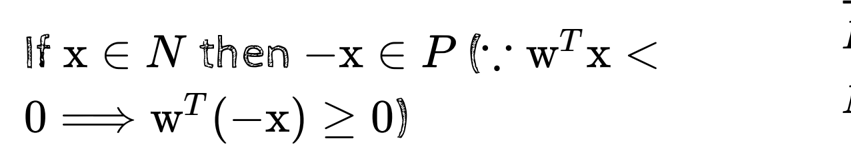

We can thus consider a single set and for every element ensure that P ′ = P ∪ N -p ∈ P ′ w p ≥ T 0
Further we will normalize all the s so that (notice that this does not affect the solution then p ′ ∥ p ∥= 1 ∵ if w ≥ T ∥ p ∥ p 0 w p ≥ T 0

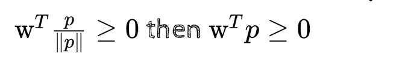

Let be the normalized solution vector (we know one exists as the data is linearly separable) w ∗

## Algorithm: Perceptron Learning Algorithm

; P ← inputs with label 1 ; N ← inputs with label 0 Initialize randomly; w while do ! convergence Pick random p ∈ P ′ = ; w w + p end end //the algorithm converges when all the inputs are classified correctly if then w ∗ ∑ i =0 n i p < i 0 ; N - ← negations of all points in N P ′ ← P ∪ N -(so now, p ← ∥ p ∥ p ∥ p ∥= 1) //notice that we do not need the other if condition because by construction we want all points in to lie P ′

## Observations:

is  some optimal solution which exists but we don't know what it is w ∗ We do not make a correction at every time-step
We make a correction only if at that time step w ⋅ T p ≤ i 0
So at time-step   we would have made only corrections t k (≤ t )
Every time we make a correction a quantity gets added to the numerator δ
So by time-step  , a quantity gets added to the numerator t kδ

## Proof:

Now suppose at time step   we inspected the point and found that t p i w ⋅ T p ≤ i 0
We make a correction w = t +1 w + t p i
Let be the angle between and β w ∗ wt +1

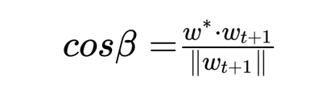

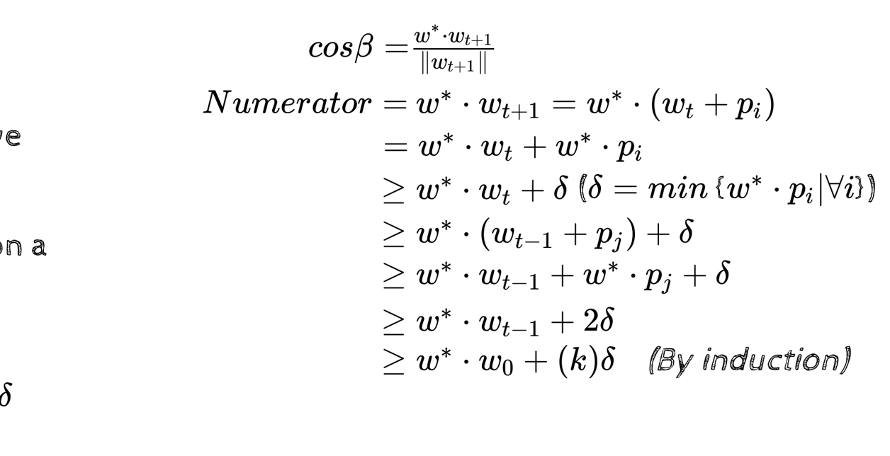

## Proof (continued):

So far we have, (and hence we made the correction) w ⋅ T p ≤ i 0

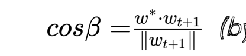

Numerator ≥ w ⋅ w 0 + ( k ) δ
Denominator

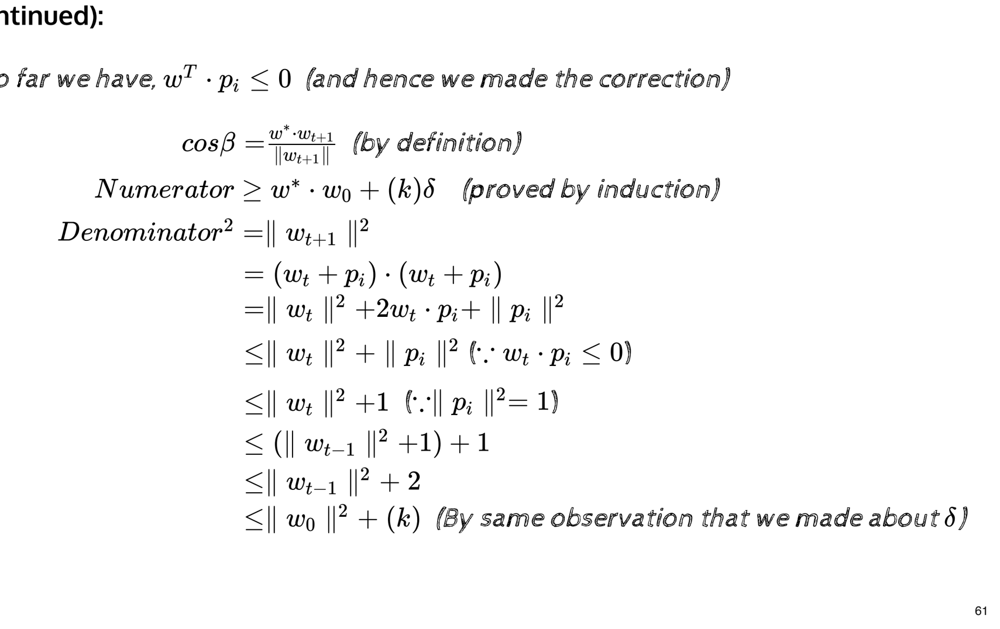

## Proof (continued):

So far we have, (and hence we made the correction) w ⋅ T p ≤ i 0

(proved by induction) Numerator ≥ w ⋅ ∗ w 0 + ( k ) δ
(By same observation that we made about ) Denominator 2 ≤∥ w 0 ∥ 2 + ( k ) δ

thus grows proportional to cosβ k
As (number of corrections) increases can become arbitrarily large k cosβ
But since , must be bounded by a maximum number cosβ ≤ 1 k
Thus, there can only be a finite number of corrections to and the algorithm will converge! ( k ) w

## Coming back to our questions

What about non-boolean (say, real) inputs? Real valued inputs are allowed in perceptron
Do we always need to hand code the threshold?
No, we can learn the threshold
Are all inputs equal? What if we want to assign more weight (importance) to some inputs? A perceptron allows weights to be assigned to inputs
What  about  functions  which  are  not  linearly  separable  ?  Not  possible  with  a  single perceptron but we will see how to handle this .. Not possible with a single perceptron but we will see how to handle this ..

## Module 2.7: Linearly Separable Boolean Function

## Mitesh M. Khapra

So what do we do about functions which are not linearly separable ?
Let us see one such simple boolean function first ?

|   x 1 |   x 2 | XOR                          |
|-------|-------|------------------------------|
|     0 |     0 | 0 w + 0 w x < ∑ i =1 2 i i 0 |
|     1 |     0 | 1 w + 0 w x ≥ ∑ i =1 2 i i 0 |
|     0 |     1 | 1 w + 0 w x ≥ ∑ i =1 2 i i 0 |
|     1 |     1 | 0 w + 0 w x < ∑ i =1 2 i i 0 |

> 📊 [Table 3 CSV](artifacts/tables/table_3.csv) | [Table 3 HTML](artifacts/tables/table_3.html)

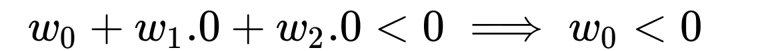

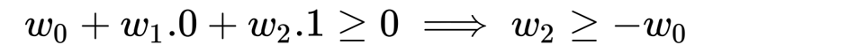

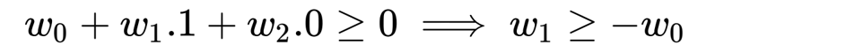

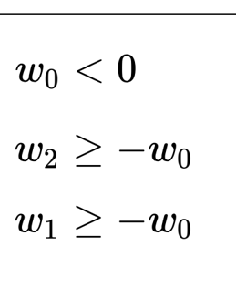

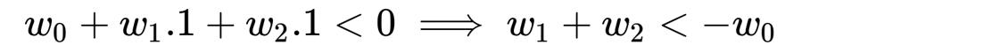

The fourth condition contradicts conditions 2 and 3
https://www.geogebra.org/material/iframe/id/quknjuyz /width/700/height/500/border/888888/sfsb/true/smb /false/stb/false/stbh/false/ai/false/asb/false/sri/false/ rc/false/ld/false/sdz/true/ctl/false
And indeed you can see that it is impossible to draw a line which separates the red points from the blue points
Hence we cannot have a solution to this set of inequalities

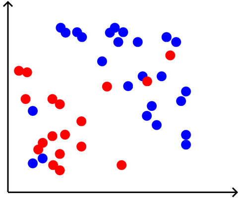

Most real world data is not linearly separable and will always contain some outliers
In fact, sometimes there may not be any outliers but still the data may not be linearly separable
We need computational units (models) which can deal with such data
While a single perceptron cannot deal with such data, we will show that a network of perceptrons can indeed deal with such data
Before seeing how a network of perceptrons can deal with linearly inseparable data, we will discuss boolean functions in some more detail ...
How many boolean functions can you design from 2 inputs ?
Let us begin with some easy ones which you already know ..

|   x 1 |   x 2 |   f 1 |   f 2 |   f 3 |   f 4 |   f 5 |   f 6 |   f 7 |   f 8 |   f 9 |   f 10 |   f 11 |   f 12 |   f 13 |   f 14 |   f 15 |   f 16 |
|-------|-------|-------|-------|-------|-------|-------|-------|-------|-------|-------|--------|--------|--------|--------|--------|--------|--------|
|     0 |     0 |     0 |     0 |     0 |     0 |     0 |     0 |     0 |     0 |     1 |      1 |      1 |      1 |      1 |      1 |      1 |      1 |
|     1 |     0 |     0 |     0 |     0 |     0 |     1 |     1 |     1 |     1 |     0 |      0 |      0 |      0 |      1 |      1 |      1 |      1 |
|     0 |     1 |     0 |     0 |     1 |     1 |     0 |     0 |     1 |     1 |     0 |      0 |      1 |      1 |      0 |      0 |      1 |      1 |
|     1 |     1 |     0 |     1 |     0 |     1 |     0 |     1 |     0 |     1 |     0 |      1 |      0 |      1 |      0 |      1 |      0 |      1 |

> 📊 [Table 4 CSV](artifacts/tables/table_4.csv) | [Table 4 HTML](artifacts/tables/table_4.html)

Of these, how many are linearly separable ? (turns out all except XOR and !XOR feel free to verify) (turns out all except XOR and !XOR - feel free to verify)
In general, how many boolean functions can you have for inputs ? n 2 2 n
How many of these functions are not linearly separable ? For the time being, it suffices  to  know  that  at  least  some  of  these  may  not  be  linearly  inseparable  (I encourage you to figure out the exact answer :-)) 2 2 n For the time being, it suffices to know that at least some of these may not be linearly inseparable (I encourage you to figure out the exact answer :-))

## Module 2.8: Representation Power of a Network of Perceptrons

Mitesh M. Khapra

We  will  now  see  how  to  implement  any  boolean  function  using  a network of perceptrons ...
y

red edge indicates = -1 w blue edge indicates
= +1 w
For this discussion, we will assume True = +1 and False = -1
We consider 2 inputs and 4 perceptrons
Each input is connected to all the 4 perceptrons with specific weights
The bias ( ) of each perceptron is (i.e., each perceptron will fire only if the weighted sum of its input is ) w 0 -2 ≥ 2
Each of these perceptrons is connected to an output perceptron by weights (which need to be learned)
The output of this perceptron ( ) is the output of this network y
y

red edge indicates w
= -1
blue edge indicates = +1 w

## Terminology:

This network contains 3 layers
The layer containing the inputs ( ) is called the input layer x , x 1 2
The middle layer containing the 4 perceptrons is called the hidden layer
The final layer containing one output neuron is called the output layer
The outputs of the 4 perceptrons in the hidden layer are denoted by h , h , h , h 1 2 3 4
The red and blue edges are called layer 1 weights are called layer 2 weights w , w , w , w 1 2 3 4

We claim that this network can be used to implement any boolean function (linearly separable or not) !
In other words, we can find such that the truth table of any boolean function can be represented by this network w , w , w , w 1 2 3 4
Astonishing claim! Well, not really, if  you understand what is going on Well, not really, if you understand what is going on
Each perceptron in the middle layer fires only for a specific input (and no two perceptrons fire for the same input)
y

We claim that this network can be used to implement any boolean function (linearly separable or not) !
In other words, we can find such that the truth table of any boolean function can be represented by this network w , w , w , w 1 2 3 4
Astonishing claim! Well, not really, if  you understand what is going on Well, not really, if you understand what is going on
Each perceptron in the middle layer fires only for a specific input (and no two perceptrons fire for the same input)
the first perceptron fires for {-1,-1}
y

We claim that this network can be used to implement any boolean function (linearly separable or not) !
In other words, we can find such that the truth table of any boolean function can be represented by this network w , w , w , w 1 2 3 4
Astonishing claim! Well, not really, if  you understand what is going on Well, not really, if you understand what is going on
Each perceptron in the middle layer fires only for a specific input (and no two perceptrons fire for the same input)
the second perceptron fires for {-1,1}
y

We claim that this network can be used to implement any boolean function (linearly separable or not) !
In other words, we can find such that the truth table of any boolean function can be represented by this network w , w , w , w 1 2 3 4
Astonishing claim! Well, not really, if  you understand what is going on Well, not really, if you understand what is going on
Each perceptron in the middle layer fires only for a specific input (and no two perceptrons fire for the same input)
the third perceptron fires for {1,-1}
y

red edge indicates w
= -1
blue edge indicates = +1 w
We claim that this network can be used to implement any boolean function (linearly separable or not) !
In other words, we can find such that the truth table of any boolean function can be represented by this network w , w , w , w 1 2 3 4
Astonishing claim! Well, not really, if  you understand what is going on Well, not really, if you understand what is going on
Each perceptron in the middle layer fires only for a specific input (and no two perceptrons fire for the same input)
the fourth perceptron fires for {1,1}
y

red edge indicates w
= -1
blue edge indicates = +1 w
We claim that this network can be used to implement any boolean function (linearly separable or not) !
In other words, we can find such that the truth table of any boolean function can be represented by this network w , w , w , w 1 2 3 4
Astonishing claim! Well, not really, if  you understand what is going on Well, not really, if you understand what is going on
Each perceptron in the middle layer fires only for a specific input (and no two perceptrons fire for the same input)
Let us see why this network works by taking an example of the XOR function
y

= +1
red edge indicates = -1 w blue edge indicates w
Let be the bias output of the neuron (i.e., it will fire if w 0 w h ≥ ∑ i =1 4 i i w 0

|   x 1 x 1 |   x 2 x 2 |   XOR |   h 1 |   h 2 |   h 3 |   h 4 | w h ∑ i =1 4 i i   |
|-----------|-----------|-------|-------|-------|-------|-------|--------------------|
|         0 |         0 |     0 |     1 |     0 |     0 |     0 | w 1                |
|         0 |         1 |     1 |     0 |     1 |     0 |     0 | w 2                |
|         1 |         0 |     1 |     0 |     0 |     1 |     0 | w 3                |
|         1 |         1 |     0 |     0 |     0 |     1 |     1 | w 4                |

> 📊 [Table 5 CSV](artifacts/tables/table_5.csv) | [Table 5 HTML](artifacts/tables/table_5.html)

This results in the following four conditions to implement XOR: , , , w 1 < w 0 w 2 ≥ w 0 w 3 ≥ w 0 w 4 < w 0
Unlike before, there are no contradictions now and the system of inequalities can be satisfied
Essentially each is now responsible for one of the 4 possible inputs and can be adjusted to get the desired output for that input wi 80
y

red edge indicates = -1 w blue edge indicates = +1 w
It should be clear that the same network can be used to represent the remaining 15 boolean functions also
Each boolean function will result in a different set of non-contradicting inequalities which can be satisfied by appropriately setting w , w , w , w 1 2 3 4
Try it!
What if we have more than 3 inputs ?
Again each of the 8 perceptrons will fire only for one of the 8 inputs Each of the 8 weights in the second layer is responsible for one of the 8 inputs and can be adjusted to produce the desired output for that input
y

What if we have inputs ? n

## Theorem

Any boolean function of inputs can be represented exactly by a network of perceptrons containing 1 hidden layer with perceptrons and one output layer containing 1 perceptron n 2 n
Proof (informal:) We just saw how to construct such a network
Note: A network of perceptrons is not necessary but sufficient. For example, we already saw how to represent AND function with just 1 perceptron 2 + n 1
Catch: As increases the number of perceptrons in the hidden layers obviously increases exponentially n
Again, why do we care about boolean functions ?
How does this help us with our original problem: which was to predict whether we like a movie or not? Let us see! Let us see!
y

We are given this data about our past movie experience
For each movie, we are given the values of the various factors ( ) that we base our decision on and we are also also given the value of (like/dislike) x , x , ..., x 1 2 n y are the points for which the output was 1 and are the points for which it was p s i ′ n s i ′ 0
The data may or may not be linearly separable
The proof that we just saw tells us that it is possible to have a network of perceptrons and learn the weights in this network such that for any given or the output of the network will be the same as or (i.e., we can separate the positive and the negative points) p i n j y i y j

## The story so far...

Networks of the form that we just saw (containing, an input, output and one or more hidden layers) are called Multilayer Perceptrons (MLP, in short)
More appropriate terminology would be "Multilayered Network of Perceptrons" but MLP is the more commonly used name
The theorem that we just saw gives us the representation power of a MLP with a single hidden layer
Specifically, it tells us that a MLP with a single hidden layer can represent any boolean function