## CS6910: Fundamentals of Deep Learning

Lecture 3: Sigmoid Neurons,Gradient Descent, Feedforward Neural Networks, Representation Power of Feedforward Neural Networks.

## Mitesh M. Khapra

## Acknowledgment

For Module 3.4, I have borrowed ideas from the videos by Ryan Harris on 'visualize backpropagation' (available on youtube)
For Module 3.5, I have borrowed ideas from this excellent book* which is available online
I am sure I would have been influenced and borrowed ideas from other sources and I apologize if I have failed to acknowledge them
* http://neuralnetworksanddeeplearning.com/chap4.html

## Module 3.1: Sigmoid Neuron

## Mitesh M. Khapra

## The story ahead

Enough about boolean functions!
What about arbitrary functions of the form where (instead of and (instead of ) y = f ( x ) x ∈ R n {0, 1} n y ∈ R {0, 1}
Can we have a network which can (approximately) represent such functions ?
Before answering the above question we will have to first graduate from perceptrons to sigmoidal neurons ...

## Recall

A perceptron will fire if the weighted sum of its inputs is greater than the threshold (-w 0 )
y

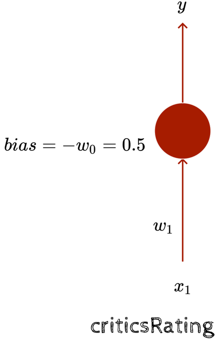

The thresholding logic used by a perceptron is very harsh !
For example, let us return to our problem of deciding whether we will like or dislike a movie
Consider that we base our decision only on one input x 1 = criticsRating ∈ (0, 1)
If the threshold is 0.5 and (-w 0 = 0.5) ( w 1 = 1)
What about a movie with criticsRating = 0.49 ? (dislike)
then what would be the decision for a movie with criticsRating = 0.51 ? (like)
It seems harsh that we would like a movie with rating 0.51 but not one with a rating of 0.49

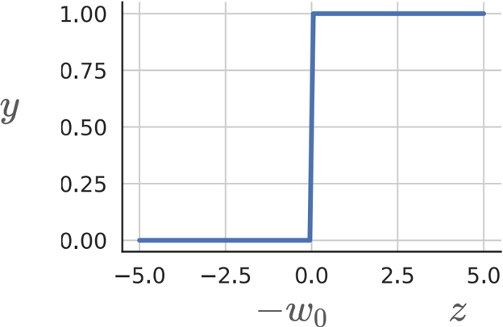

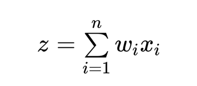

This behavior is not a characteristic of the specific problem we chose or the specific weight and threshold that we chose
It is a characteristic of the perceptron function itself which behaves like a step function
There will always be this sudden change in the decision (from 0 to 1) when crosses the threshold w x i =1 ∑ n i i -w 0
For most real world applications we would expect a smoother decision function which gradually changes from 0 to 1

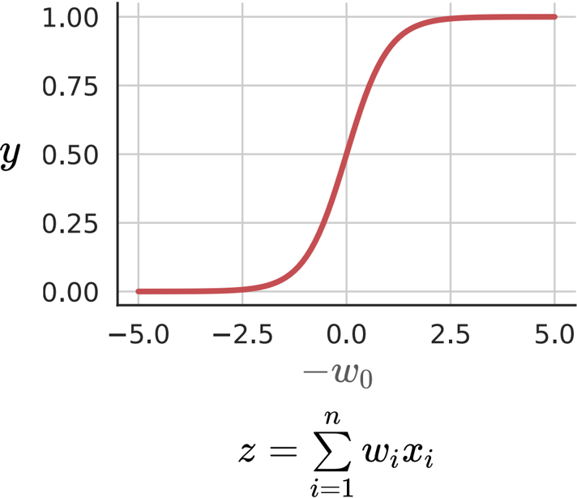

Introducing sigmoid neurons where the output function is much smoother than the step function
Here is one form of the sigmoid function called the logistic function

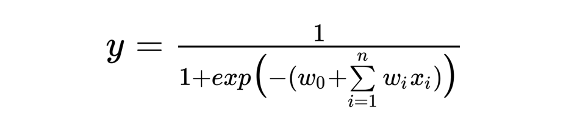

We no longer see a sharp transition around the threshold -w 0
Also the output is no longer binary but a real value between 0 and 1 which can be interpreted as a probability. y
Instead of a like/dislike decision we get the probability of liking the movie.

## Perceptron

y

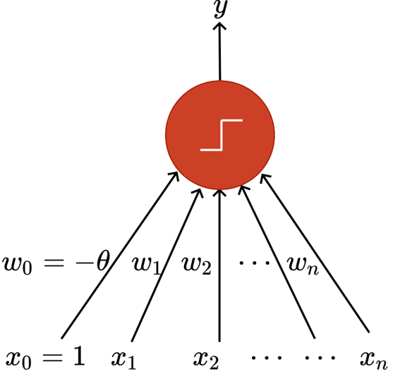

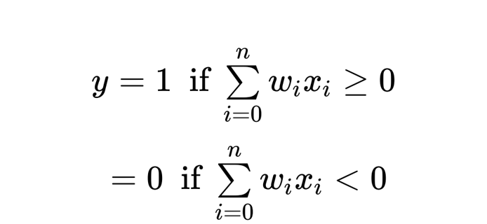

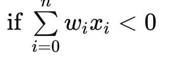

## Sigmoid (Logistic) Neuron

y

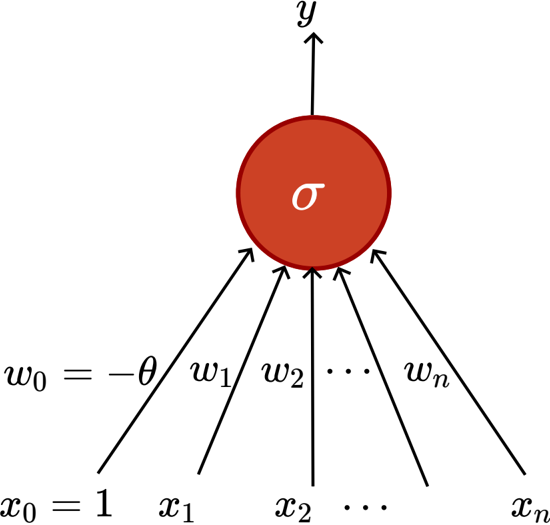

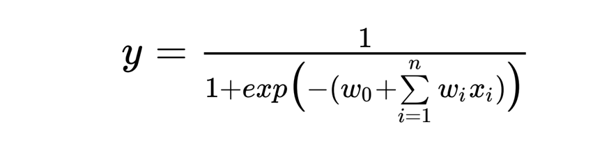

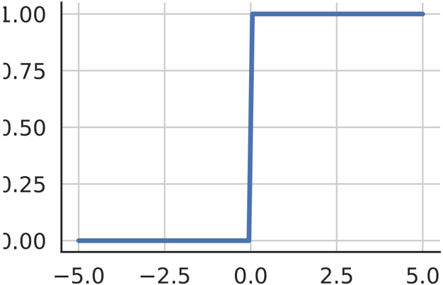

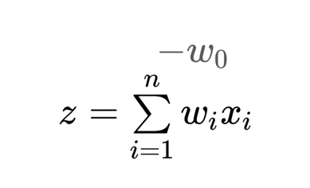

not differentiable at )
Not smooth, ( -ω 0

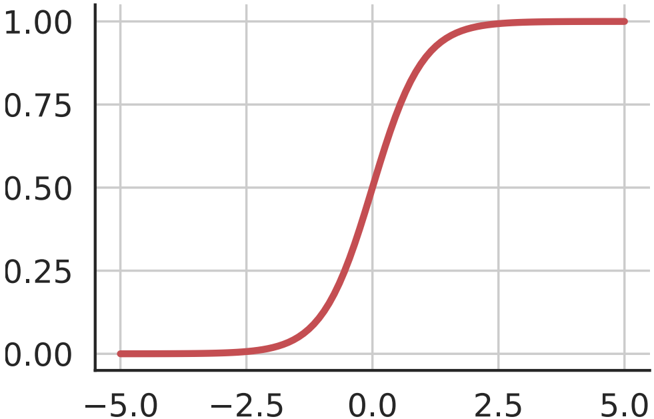

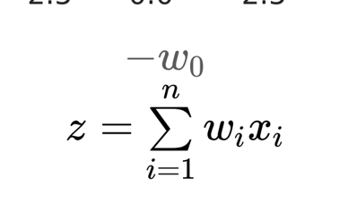

Smooth, continuous, differentiable

## Module 3.2: A typical Supervised Machine Learning Setup

## Mitesh M. Khapra

## Sigmoid (Logistic) Neuron

y

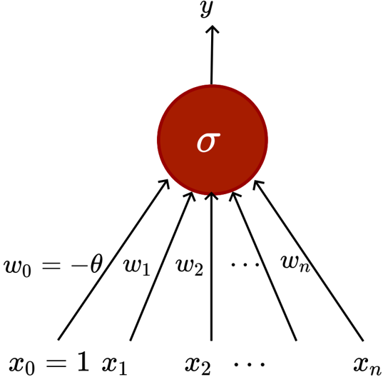

## What next ?

Well, just as we had an algorithm for learning the weights of a perceptron, we also need a way of learning the weights of a sigmoid neuron
Before we see such an algorithm we will revisit the concept of error

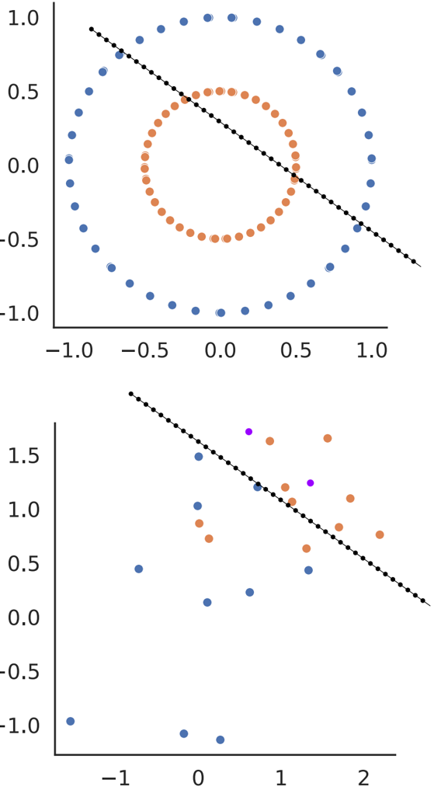

Earlier  we  mentioned  that  a single  perceptron cannot deal with these data because it is not linearly separable
What does 'cannot deal with' mean?
What  would  happen  if  we  use  a  perceptron  model  to classify these data ?
We would probably end up with  lines like these ...
From now on, we will accept that it is hard to drive the error to 0 in most cases and will instead aim to reach the minimum possible error
This  brings  us  to  a  typical  supervised  machine  learning  setup  which  has  the  following components...
Data: { x , y } i i i =1 n
Model: Our approximation of the relation between and . x y

Parameters : In all the above cases, is a parameter which needs to be learned from the data w
Learning algorithm: An algorithm for learning the parameters of the model (for example, perceptron learning algorithm, gradient descent, etc.) w
Objective/Loss/Error function: To guide the learning algorithm the learning algorithm should aim to minimize the loss function

## As an illustration, consider our movie example

Data: { movie, (like/dislike) x = i y = i } i =1 n
Model: Our approximation of the relation between x and y (the probability of liking a movie)

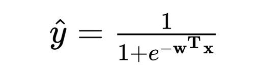

Parameters: w
Learning algorithm: gradient descent (We will see soon)
One Possibility is n 2
Objective/Loss/Error function:

The learning algorithm should aim to find a which minimizes the above function (squared error between ) w y and y ^

## Module 3.3: Learning Parameters : (Infeasible) Guess Work

Mitesh M. Khapra

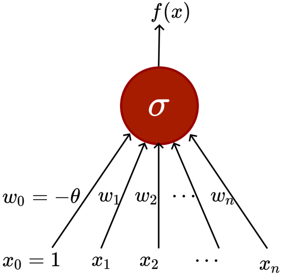

Keeping this supervised ML setup in mind, we will now focus on this model and discuss an algorithm for learning the parameters of this model from some given data using an appropriate objective function stands for the sigmoid function (logistic function in this case) σ

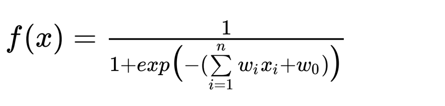

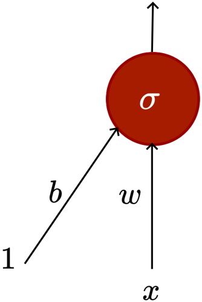

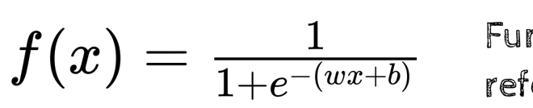

Keeping this supervised ML setup in mind, we will now focus on this model and discuss an algorithm for learning the parameters of this model from some given data using an appropriate objective function stands for the sigmoid function (logistic function in this case) σ
For ease of explanation, we will consider a very simplified version of the model having just 1 input
Further to be consistent with the literature, from now on, we will refer to as (bias) w 0 b
Lastly, instead of considering the problem of predicting like/dislike , we will assume that we want to predict criticsRating( ) given imdbRating( ) (for no particular reason) y x

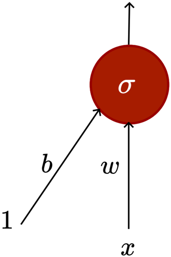

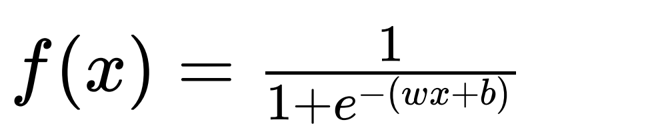

## Input for Training

## Training Objective

Find and such that w b

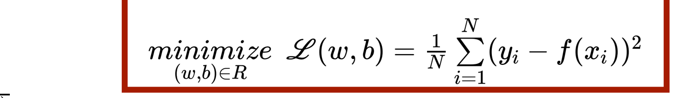

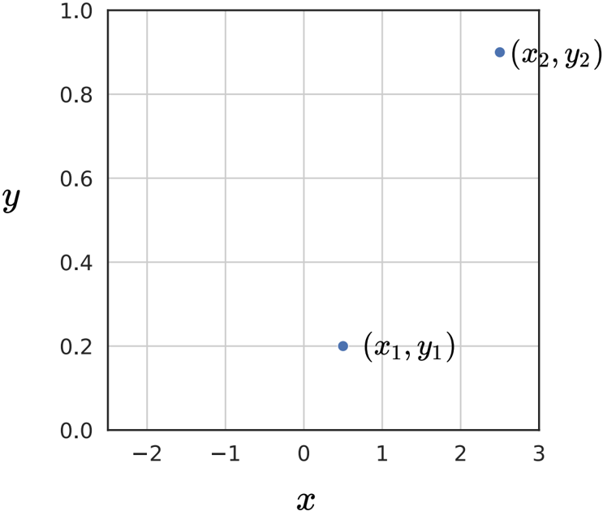

## What does it mean to train the network?

Suppose we train the network with and ( x , y ) = (0.5, 0.2) (2.5, 0.9)
At the end of training we expect to find , such that: w ∗ b ∗

## In other words

We hope to find a sigmoid function such that and lie on this sigmoid (0.5, 0.2) (2.5, 0.9)

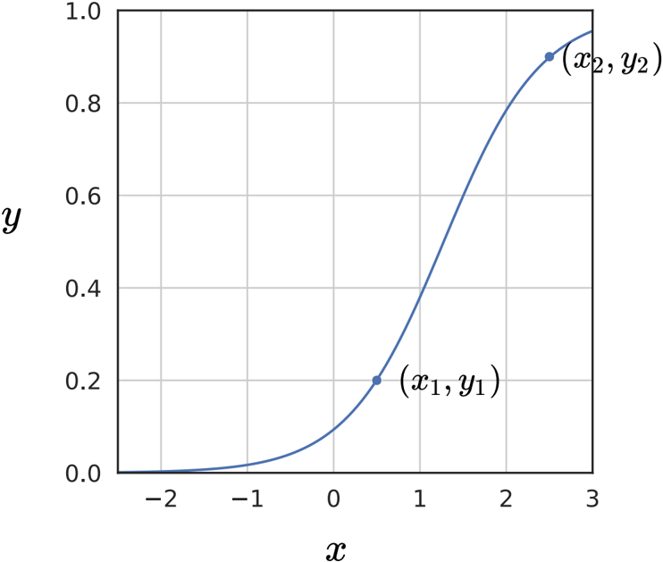

## What does it mean to train the network?

Suppose we train the network with and ( x , y ) = (0.5, 0.2) (2.5, 0.9)
At the end of training we expect to find , such that: w ∗ b ∗

## In other words

We hope to find a sigmoid function such that and lie on this sigmoid (0.5, 0.2) (2.5, 0.9)

## Let us see this in more detail ...

https://www.geogebra.org/material/iframe/id/ mt5jqzcz/width/600/height/600/border/8888 88/sfsb/true/smb/false/stb/false/stbh/false/ai /false/asb/false/sri/false/rc/false/ld/false/sdz /true/ctl/false
Can we find manually? w , b ∗ ∗
Let us start with a Random Guess:

Clearly, it is not good, but how bad is it ?
Let us revisit to see how bad it is ... L ( w , b )
https://www.geogebra.org/material/iframe/id/ mt5jqzcz/width/600/height/600/border/88888 8/sfsb/true/smb/false/stb/false/stbh/false/ai/ false/asb/false/sri/false/rc/false/ld/false/sdz/t rue/ctl/false

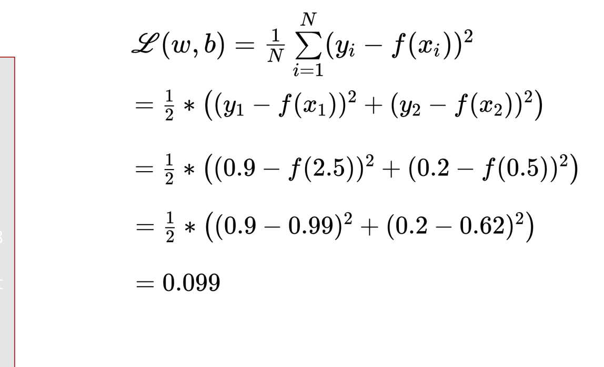

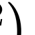

We want to be as close to zero as possible L ( w , b )
Let us try some other values for by changing the sliders ( w , b )
https://www.geogebra.org/material/iframe/id/ mt5jqzcz/width/600/height/600/border/88888 8/sfsb/true/smb/false/stb/false/stbh/false/ai/ false/asb/false/sri/false/rc/false/ld/false/sdz/t rue/ctl/false

|     w |     b |   Loss |
|-------|-------|--------|
|  0.5  |  0    | 0.073  |
| -0.1  |  0    | 0.14   |
|  0.94 | -0.94 | 0.0214 |
|  1.42 | -1.73 | 0.0028 |
|  1.65 | -2.08 | 0.0003 |
|  1.78 | -2.27 | 0      |

> 📊 [Table 1 CSV](artifacts/tables/table_1.csv) | [Table 1 HTML](artifacts/tables/table_1.html)

## A few Snapshots

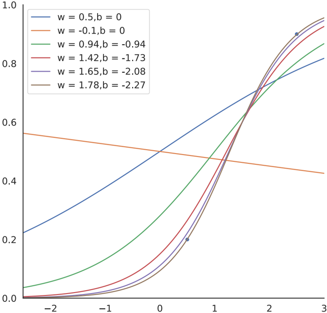

|     w |     b |   Loss |
|-------|-------|--------|
|  0.5  |  0    | 0.073  |
| -0.1  |  0    | 0.14   |
|  0.94 | -0.94 | 0.0214 |
|  1.42 | -1.73 | 0.0028 |
|  1.65 | -2.08 | 0.0003 |
|  1.78 | -2.27 | 0      |

> 📊 [Table 2 CSV](artifacts/tables/table_2.csv) | [Table 2 HTML](artifacts/tables/table_2.html)

Let  us  Look  for  something  better  than  our "Guess work Algorithm"..
https://arunprakash-a.github.io/plotly/errorSurface.html

## Random Search on Error Surface

Since we have only 2 points and 2 parameters we can easily plot for different values of and pick the one where is minimum ( w , b ) L ( w , b ) ( w , b ) L ( w , b )
But of course this becomes intractable once you have many more data points and many more parameters !!
Further, even here we have plotted the error surface only for a small range of [from ( -6, + 6) and not from ] ( w , b ) (-∞,+∞)
Let us look at the geometric interpretation of our 'guess work' algorithm in terms of this error surface

## Play with the Search Space

https://www.geogebra.org/material/iframe/id/nhhsuf5z/width/1200/height/500/border/888888/sfsb/true/smb/false/ stb/false/stbh/false/ai/false/asb/false/sri/false/rc/false/ld/false/sdz/true/ctl/false

|     w |     b |   Loss |
|-------|-------|--------|
|  0.5  |  0    | 0.073  |
| -0.1  |  0    | 0.14   |
|  0.94 | -0.94 | 0.0214 |
|  1.42 | -1.73 | 0.0028 |
|  1.65 | -2.08 | 0.0003 |
|  1.78 | -2.27 | 0      |

> 📊 [Table 3 CSV](artifacts/tables/table_3.csv) | [Table 3 HTML](artifacts/tables/table_3.html)

## Module 3.4: Learning Parameters : Gradient Descent

Mitesh M. Khapra

## Goal

Find a better way of traversing the error surface so that we can  reach  the  minimum  value  quickly  without  resorting  to brute force search!
Vector of parameters, say, randomly initialized
θ
= [
w
,
b
]

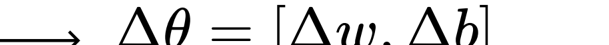

change in the value of w , b

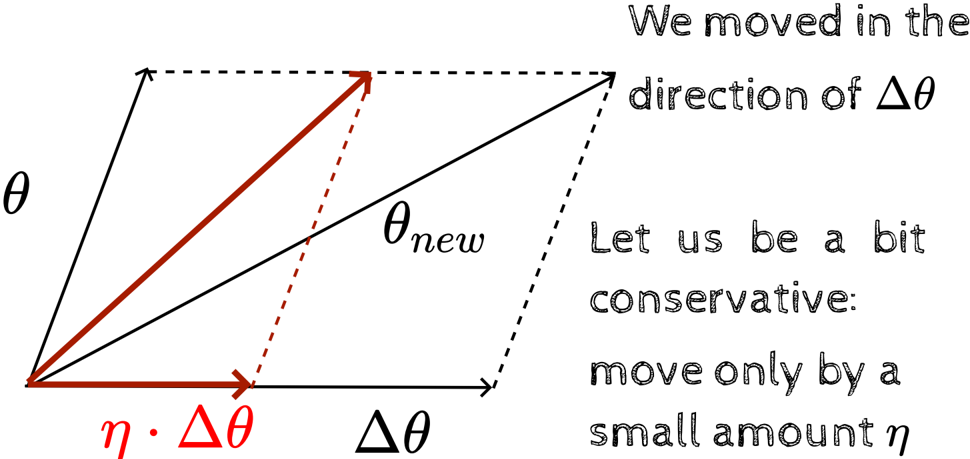

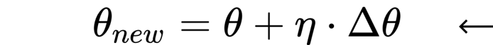

Question: What is the right to use ? Δ θ
The answer comes from Taylor series

## What is Taylor Series?

° (W0)
Taylor series is a way of approximating any continuously differentiable function using polynomials of degree . The higher the degree the better the approximation!. L ( w ) n

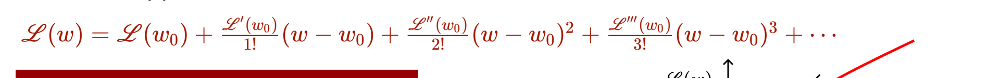

## Linear Approximation ( ) n = 1

## Quadratic Approximation ( ) n = 2

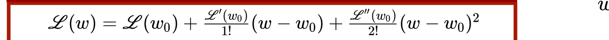

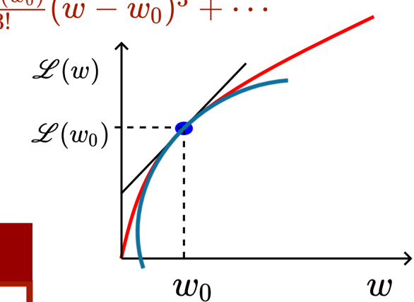

## Taylor Series Approximation

https://www.geogebra.org/material/iframe/id/bqfthg42/width/1000/height/600/ border/888888/sfsb/true/smb/false/stb/false/stbh/false/ai/false/asb/false/sri/f alse/rc/false/ld/false/sdz/true/ctl/false
Try with different such as and see how closely Taylor series approximate the function at the point and around its neighbour L ( w ) exp ( w ), sin ( w ), w 3 ⋯ w = w 0 ϵ

## Approximating 2D function

https://www.geogebra.org/material/iframe/id/wwurzpn2/width/1200/height/700/border/888888/ sfsb/true/smb/false/stb/false/stbh/false/ai/false/asb/false/sri/false/rc/false/ld/false/sdz/true/ctl /false
For ease of notation, let , then from Taylor series, we have, Δ θ = u

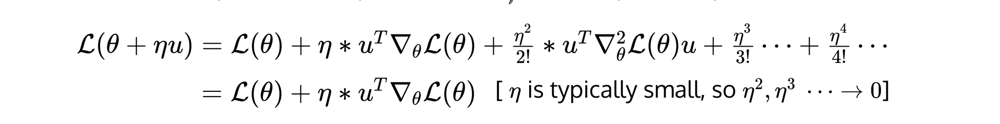

Note that the move would be favorable only if ηu
L ( θ + ηu ) -L ( θ ) < 0 [i.e., if the new loss is less than the previous loss]
This implies,

But, what is the range of ? u ∇ L ( θ ) T θ
Let be the angle between and , then we know that β u T ∇ L ( θ ) θ

Multiply throught k = ∣∣ u ∣∣ ∗ T ∣∣∇ L ( θ )∣∣ θ

Thus is most negative when (i.e., = ) L ( θ + ηu ) -L ( θ ) = u ∇ L ( θ ) = T θ k ∗ cos( β ) cos( β ) = -1 β 180 o

## Land at Local Minima with Gradient as Guidance

Set initially. The function is evaluated for initial value of and notice the gradient ( ) value. η = 1 f ( w ) w = 1.2 dw
Change the value of according to the gradient value. That is, take a step ( Just enter in the input box for the first iteration and follow the same for the rest ) w w ± ηdw 1.2 - 0.31
After a few iterations, did you land at the local minimum?
If no, Repeat the game and make necessary changes to land at local minimum.
https://www.geogebra.org/material/iframe/id/xdrv4wg4/width /700/height/500/border/888888/sfsb/true/smb/false/stb/fals e/stbh/false/ai/false/asb/false/sri/false/rc/false/ld/false/sdz/t rue/ctl/false

## Gradient Descent Rule

The direction that we intend to move in should be at 180° w.r.t. the gradient In other words, move in a direction opposite to the gradient u

## Parameter Updation Rule

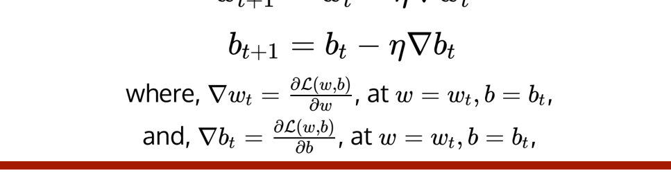

So we now have a more principled way of moving in the ( ) plane than our 'guess work' algorithm w , b

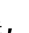

## Algorithm: gradient_descent()

max_iterarions ; w,b initialize randomly while max_iterations do ; ; end t ←0; ←1000 ← t < w ← t +1 w -t η ∇ wt b ← t +1 b -t η ∇ b t t ← t +1;
max_iterations = 1000 w = random() b = random() while max_iterations: w = w - eta*dw b = b - eta*db max_iterations -= 1 1 2 3 4 5 6 7
)

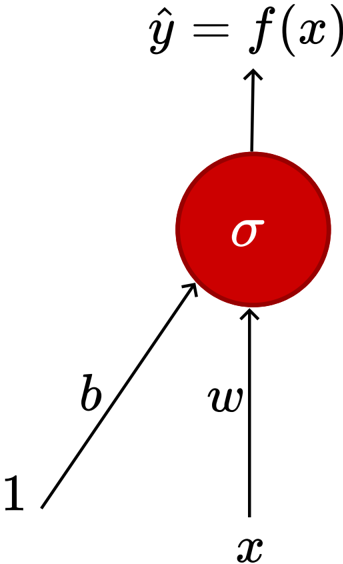

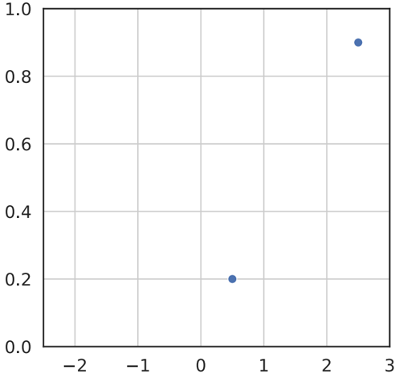

Let us assume there is only one point to fit

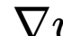

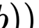

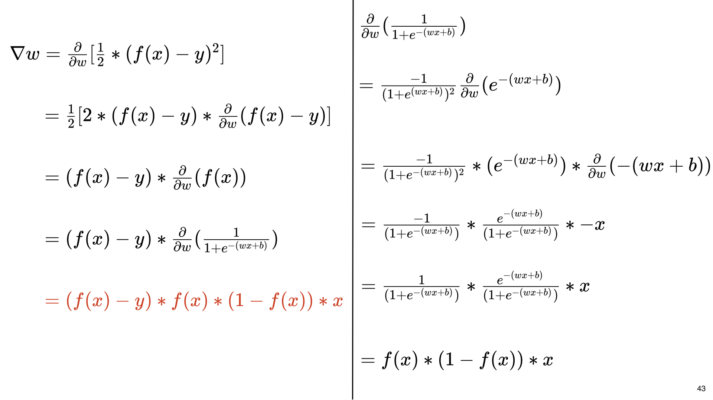

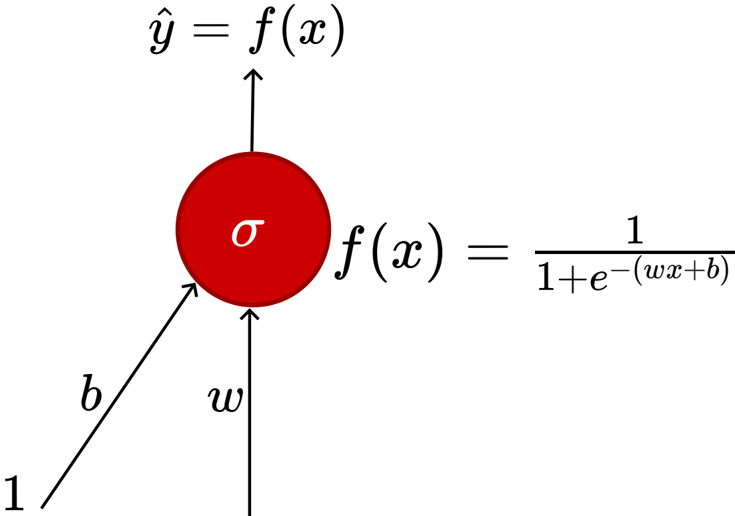

x

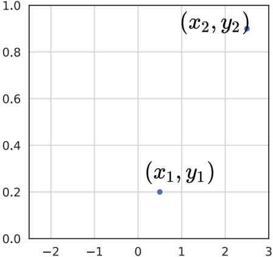

So If we have only one point ( ), we have, x , y

For two points,

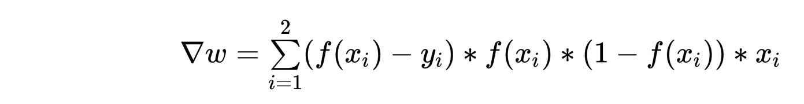

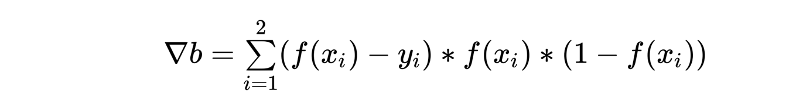

import numpy as np X = [0.5,2.5] Y = [0.2,0.9] 1 2 3 4 def f(x,w,b): 5 return 1/(1+np.exp(-(w*x+b))) 6 7 def error(w,b): 8 err = 0.0 9 for x,y in zip(X,Y): 10 fx = f(x,w,b) 11 err += (fx-y)**2 12 return 0.5*err 13 14 def grad_b(x,w,b,y): 15 fx = f(x,w,b) 16 return (fx-y)*fx*(1-fx) 17 18 def grad_w(x,w,b,y): 19 fx = f(x,w,b) 20 return (fx-y)*fx*(1-fx)*x 21 22 def do_gradient_descent(): 23 24 w,b,eta,max_epochs = -2,-2,1.0,1000 25 26 for i in range(max_epochs): 27 dw,db = 0,0 28 for x,y in zip(X,Y): 29 dw += grad_w(x,w,b,y) 30 db += grad_b(x,w,b,y) 31 32 w = w - eta*dw 33 b = b - eta*db 34 def do_gradient_descent(): w,b,eta,max_epochs = -2,-2,1.0,1000 for i in range(max_epochs): dw,db = 0,0 for x,y in zip(X,Y): dw += grad_w(x,w,b,y) import numpy as np 1 X = [0.5,2.5] 2 Y = [0.2,0.9] 3 4 def f(x,w,b): 5 return 1/(1+np.exp(-(w*x+b))) 6 7 def error(w,b): 8 err = 0.0 9 for x,y in zip(X,Y): 10 fx = f(x,w,b) 11 err += (fx-y)**2 12 return 0.5*err 13 14 def grad_b(x,w,b,y): 15 fx = f(x,w,b) 16 return (fx-y)*fx*(1-fx) 17 18 def grad_w(x,w,b,y): 19 fx = f(x,w,b) 20 return (fx-y)*fx*(1-fx)*x 21 22 23 24 25 26 27 28 29 30 db += grad_b(x,w,b,y) 31 32 w = w - eta*dw 33 b = b - eta*db 34 dw += grad_w(x,w,b,y) import numpy as np 1 X = [0.5,2.5] 2 Y = [0.2,0.9] 3 4 def f(x,w,b): 5 return 1/(1+np.exp(-(w*x+b))) 6 7 def error(w,b): 8 err = 0.0 9 for x,y in zip(X,Y): 10 fx = f(x,w,b) 11 err += (fx-y)**2 12 return 0.5*err 13 14 def grad_b(x,w,b,y): 15 fx = f(x,w,b) 16 return (fx-y)*fx*(1-fx) 17 18 def grad_w(x,w,b,y): 19 fx = f(x,w,b) 20 return (fx-y)*fx*(1-fx)*x 21 22 def do_gradient_descent(): 23 24 w,b,eta,max_epochs = -2,-2,1.0,1000 25 26 for i in range(max_epochs): 27 dw,db = 0,0 28 for x,y in zip(X,Y): 29 30 db += grad_b(x,w,b,y) 31 32 w = w - eta*dw 33 b = b - eta*db 34 def grad_w(x,w,b,y): fx = f(x,w,b) return (fx-y)*fx*(1-fx)*x import numpy as np 1 X = [0.5,2.5] 2 Y = [0.2,0.9] 3 4 def f(x,w,b): 5 return 1/(1+np.exp(-(w*x+b))) 6 7 def error(w,b): 8 err = 0.0 9 for x,y in zip(X,Y): 10 fx = f(x,w,b) 11 err += (fx-y)**2 12 return 0.5*err 13 14 def grad_b(x,w,b,y): 15 fx = f(x,w,b) 16 return (fx-y)*fx*(1-fx) 17 18 19 20 21 22 def do_gradient_descent(): 23 24 w,b,eta,max_epochs = -2,-2,1.0,1000 25 26 for i in range(max_epochs): 27 dw,db = 0,0 28 for x,y in zip(X,Y): 29 dw += grad_w(x,w,b,y) 30 db += grad_b(x,w,b,y) 31 32 w = w - eta*dw 33 b = b - eta*db 34 fx = f(x,w,b) import numpy as np 1 X = [0.5,2.5] 2 Y = [0.2,0.9] 3 4 def f(x,w,b): 5 return 1/(1+np.exp(-(w*x+b))) 6 7 def error(w,b): 8 err = 0.0 9 for x,y in zip(X,Y): 10 fx = f(x,w,b) 11 err += (fx-y)**2 12 return 0.5*err 13 14 def grad_b(x,w,b,y): 15 fx = f(x,w,b) 16 return (fx-y)*fx*(1-fx) 17 18 def grad_w(x,w,b,y): 19 20 return (fx-y)*fx*(1-fx)*x 21 22 def do_gradient_descent(): 23 24 w,b,eta,max_epochs = -2,-2,1.0,1000 25 26 for i in range(max_epochs): 27 dw,db = 0,0 28 for x,y in zip(X,Y): 29 dw += grad_w(x,w,b,y) 30 db += grad_b(x,w,b,y) 31 32 w = w - eta*dw 33 b = b - eta*db 34 def f(x,w,b): return 1/(1+np.exp(-(w*x+b))) import numpy as np 1 X = [0.5,2.5] 2 Y = [0.2,0.9] 3 4 5 6 7 def error(w,b): 8 err = 0.0 9 for x,y in zip(X,Y): 10 fx = f(x,w,b) 11 err += (fx-y)**2 12 return 0.5*err 13 14 def grad_b(x,w,b,y): 15 fx = f(x,w,b) 16 return (fx-y)*fx*(1-fx) 17 18 def grad_w(x,w,b,y): 19 fx = f(x,w,b) 20 return (fx-y)*fx*(1-fx)*x 21 22 def do_gradient_descent(): 23 24 w,b,eta,max_epochs = -2,-2,1.0,1000 25 26 for i in range(max_epochs): 27 dw,db = 0,0 28 for x,y in zip(X,Y): 29 dw += grad_w(x,w,b,y) 30 db += grad_b(x,w,b,y) 31 32 w = w - eta*dw 33 b = b - eta*db 34 db += grad_b(x,w,b,y) import numpy as np 1 X = [0.5,2.5] 2 Y = [0.2,0.9] 3 4 def f(x,w,b): 5 return 1/(1+np.exp(-(w*x+b))) 6 7 def error(w,b): 8 err = 0.0 9 for x,y in zip(X,Y): 10 fx = f(x,w,b) 11 err += (fx-y)**2 12 return 0.5*err 13 14 def grad_b(x,w,b,y): 15 fx = f(x,w,b) 16 return (fx-y)*fx*(1-fx) 17 18 def grad_w(x,w,b,y): 19 fx = f(x,w,b) 20 return (fx-y)*fx*(1-fx)*x 21 22 def do_gradient_descent(): 23 24 w,b,eta,max_epochs = -2,-2,1.0,1000 25 26 for i in range(max_epochs): 27 dw,db = 0,0 28 for x,y in zip(X,Y): 29 dw += grad_w(x,w,b,y) 30 31 32 w = w - eta*dw 33 b = b - eta*db 34 def grad_b(x,w,b,y): fx = f(x,w,b) return (fx-y)*fx*(1-fx) import numpy as np 1 X = [0.5,2.5] 2 Y = [0.2,0.9] 3 4 def f(x,w,b): 5 return 1/(1+np.exp(-(w*x+b))) 6 7 def error(w,b): 8 err = 0.0 9 for x,y in zip(X,Y): 10 fx = f(x,w,b) 11 err += (fx-y)**2 12 return 0.5*err 13 14 15 16 17 18 def grad_w(x,w,b,y): 19 fx = f(x,w,b) 20 return (fx-y)*fx*(1-fx)*x 21 22 def do_gradient_descent(): 23 24 w,b,eta,max_epochs = -2,-2,1.0,1000 25 26 for i in range(max_epochs): 27 dw,db = 0,0 28 for x,y in zip(X,Y): 29 dw += grad_w(x,w,b,y) 30 db += grad_b(x,w,b,y) 31 32 w = w - eta*dw 33 b = b - eta*db 34 def f(x,w,b): return 1/(1+np.exp(-(w*x+b))) import numpy as np 1 X = [0.5,2.5] 2 Y = [0.2,0.9] 3 4 5 6 7 def error(w,b): 8 err = 0.0 9 for x,y in zip(X,Y): 10 fx = f(x,w,b) 11 err += (fx-y)**2 12 return 0.5*err 13 14 def grad_b(x,w,b,y): 15 fx = f(x,w,b) 16 return (fx-y)*fx*(1-fx) 17 18 def grad_w(x,w,b,y): 19 fx = f(x,w,b) 20 return (fx-y)*fx*(1-fx)*x 21 22 def do_gradient_descent(): 23 24 w,b,eta,max_epochs = -2,-2,1.0,1000 25 26 for i in range(max_epochs): 27 dw,db = 0,0 28 for x,y in zip(X,Y): 29 dw += grad_w(x,w,b,y) 30 db += grad_b(x,w,b,y) 31 32 w = w - eta*dw 33 b = b - eta*db 34 w = w - eta*dw b = b - eta*db import numpy as np 1 X = [0.5,2.5] 2 Y = [0.2,0.9] 3 4 def f(x,w,b): 5 return 1/(1+np.exp(-(w*x+b))) 6 7 def error(w,b): 8 err = 0.0 9 for x,y in zip(X,Y): 10 fx = f(x,w,b) 11 err += (fx-y)**2 12 return 0.5*err 13 14 def grad_b(x,w,b,y): 15 fx = f(x,w,b) 16 return (fx-y)*fx*(1-fx) 17 18 def grad_w(x,w,b,y): 19 fx = f(x,w,b) 20 return (fx-y)*fx*(1-fx)*x 21 22 def do_gradient_descent(): 23 24 w,b,eta,max_epochs = -2,-2,1.0,1000 25 26 for i in range(max_epochs): 27 dw,db = 0,0 28 for x,y in zip(X,Y): 29 dw += grad_w(x,w,b,y) 30 db += grad_b(x,w,b,y) 31 32 33 34 def error(w,b): err = 0.0 for x,y in zip(X,Y): fx = f(x,w,b) err += (fx-y)**2 return 0.5*err import numpy as np 1 X = [0.5,2.5] 2 Y = [0.2,0.9] 3 4 def f(x,w,b): 5 return 1/(1+np.exp(-(w*x+b))) 6 7 8 9 10 11 12 13 14 def grad_b(x,w,b,y): 15 fx = f(x,w,b) 16 return (fx-y)*fx*(1-fx) 17 18 def grad_w(x,w,b,y): 19 fx = f(x,w,b) 20 return (fx-y)*fx*(1-fx)*x 21 22 def do_gradient_descent(): 23 24 w,b,eta,max_epochs = -2,-2,1.0,1000 25 26 for i in range(max_epochs): 27 dw,db = 0,0 28 for x,y in zip(X,Y): 29 dw += grad_w(x,w,b,y) 30 db += grad_b(x,w,b,y) 31 32 w = w - eta*dw 33 b = b - eta*db 34 def do_gradient_descent(): w,b,eta,max_epochs = -2,-2,1.0,1000 for i in range(max_epochs): dw,db = 0,0 for x,y in zip(X,Y): dw += grad_w(x,w,b,y) db += grad_b(x,w,b,y) w = w - eta*dw b = b - eta*db import numpy as np 1 X = [0.5,2.5] 2 Y = [0.2,0.9] 3 4 def f(x,w,b): 5 return 1/(1+np.exp(-(w*x+b))) 6 7 def error(w,b): 8 err = 0.0 9 for x,y in zip(X,Y): 10 fx = f(x,w,b) 11 err += (fx-y)**2 12 return 0.5*err 13 14 def grad_b(x,w,b,y): 15 fx = f(x,w,b) 16 return (fx-y)*fx*(1-fx) 17 18 def grad_w(x,w,b,y): 19 fx = f(x,w,b) 20 return (fx-y)*fx*(1-fx)*x 21 22 23 24 25 26 27 28 29 30 31 32 33 34 def error(w,b): err = 0.0 for x,y in zip(X,Y): fx = f(x,w,b) err += (fx-y)**2 return 0.5*err import numpy as np 1 X = [0.5,2.5] 2 Y = [0.2,0.9] 3 4 def f(x,w,b): 5 return 1/(1+np.exp(-(w*x+b))) 6 7 8 9 10 11 12 13 14 def grad_b(x,w,b,y): 15 fx = f(x,w,b) 16 return (fx-y)*fx*(1-fx) 17 18 def grad_w(x,w,b,y): 19 fx = f(x,w,b) 20 return (fx-y)*fx*(1-fx)*x 21 22 def do_gradient_descent(): 23 24 w,b,eta,max_epochs = -2,-2,1.0,1000 25 26 for i in range(max_epochs): 27 dw,db = 0,0 28 for x,y in zip(X,Y): 29 dw += grad_w(x,w,b,y) 30 db += grad_b(x,w,b,y) 31 32 w = w - eta*dw 33 b = b - eta*db 34 def do_gradient_descent(): w,b,eta,max_epochs = -2,-2,1.0,1000 for i in range(max_epochs): dw,db = 0,0 for x,y in zip(X,Y): dw += grad_w(x,w,b,y) db += grad_b(x,w,b,y) w = w - eta*dw b = b - eta*db import numpy as np 1 X = [0.5,2.5] 2 Y = [0.2,0.9] 3 4 def f(x,w,b): 5 return 1/(1+np.exp(-(w*x+b))) 6 7 def error(w,b): 8 err = 0.0 9 for x,y in zip(X,Y): 10 fx = f(x,w,b) 11 err += (fx-y)**2 12 return 0.5*err 13 14 def grad_b(x,w,b,y): 15 fx = f(x,w,b) 16 return (fx-y)*fx*(1-fx) 17 18 def grad_w(x,w,b,y): 19 fx = f(x,w,b) 20 return (fx-y)*fx*(1-fx)*x 21 22 23 24 25 26 27 28 29 30 31 32 33 34 def error(w,b): err = 0.0 for x,y in zip(X,Y): fx = f(x,w,b) err += (fx-y)**2 return 0.5*err import numpy as np 1 X = [0.5,2.5] 2 Y = [0.2,0.9] 3 4 def f(x,w,b): 5 return 1/(1+np.exp(-(w*x+b))) 6 7 8 9 10 11 12 13 14 def grad_b(x,w,b,y): 15 fx = f(x,w,b) 16 return (fx-y)*fx*(1-fx) 17 18 def grad_w(x,w,b,y): 19 fx = f(x,w,b) 20 return (fx-y)*fx*(1-fx)*x 21 22 def do_gradient_descent(): 23 24 w,b,eta,max_epochs = -2,-2,1.0,1000 25 26 for i in range(max_epochs): 27 dw,db = 0,0 28 for x,y in zip(X,Y): 29 dw += grad_w(x,w,b,y) 30 db += grad_b(x,w,b,y) 31 32 w = w - eta*dw 33 b = b - eta*db 34
https://arunprakash-a.github.io/plotly/errorSurface.html

## Let us do_gradient_descent()

https://www.geogebra.org/material/iframe/id/nysbhyky/width/1000/height/500/borde r/888888/sfsb/true/smb/false/stb/false/stbh/false/ai/false/asb/false/sri/false/rc/false /ld/false/sdz/true/ctl/false
Later on in the course we will look at gradient descent in much more detail and discuss its variants
For the time being it suffices to know that we have an algorithm for learning the parameters of a sigmoid neuron
So where do we head from here ?
Module 3.5: Representation Power of a Multilayer Network of Sigmoid Neurons
Mitesh M. Khapra

## Representation power of a multilayer network of perceptrons

A multilayer network of perceptrons with a single hidden layer can be used to represent any boolean function precisely (no errors)

## Representation power of a multilayer network of sigmoid neurons

A multilayer network of neurons with a single hidden layer can be used to approximate any continuous function to any desired precision
In other words, there is a guarantee that for any function , we can always find a neural network (with 1 hidden layer containing enough neurons) whose output satisfies !! f ( x ) : R → n R m g ( x ) ∣ g ( x )-f ( x )∣ < ϵ
Proof: We will see an illustrative proof of this... [Cybenko, 1989], [Hornik, 1991]
See this link* for an excellent illustration of this proof
The discussion in the next few slides is based on the ideas presented at the above link
* http://neuralnetworksanddeeplearning.com/chap4.html

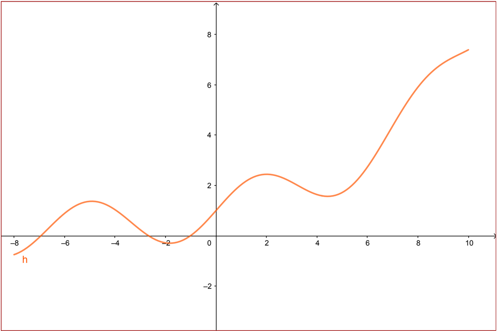

We are interested in knowing whether a network of neurons can be used to represent an arbitrary function (like the one shown in the figure)
https://www.geogebra.org/material/iframe/id/unjcstna/width/1518/height/631/border/888888/sfsb/true/sm b/false/stb/false/stbh/false/ai/false/asb/false/sri/false/rc/false/ld/false/sdz/false/ctl/false
We observe that such an arbitrary function can be approximated by several 'tower' functions
More the number of such 'tower' functions, better the approximation

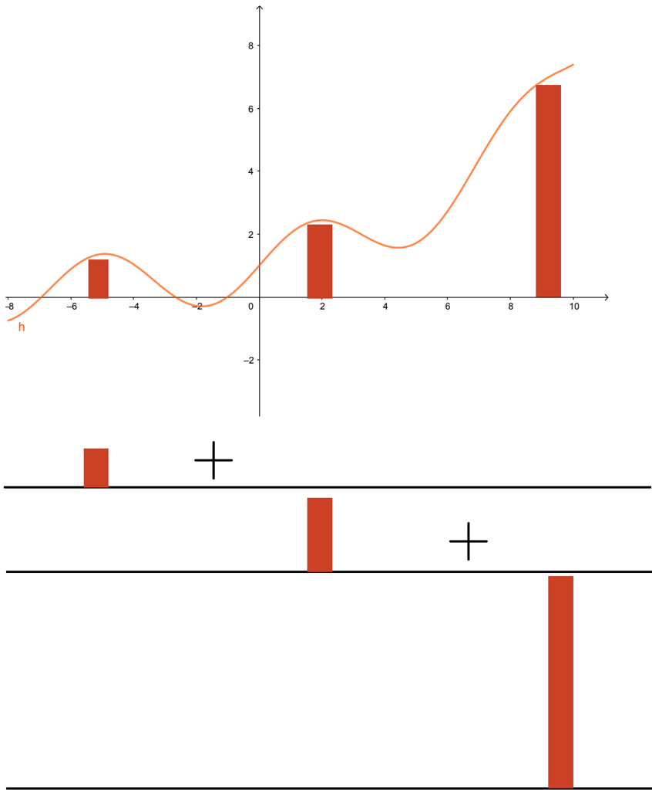

To be more precise, we can approximate any arbitrary function by a sum of such 'tower' functions
Sifting Property of Tower function (impulse or delta function)

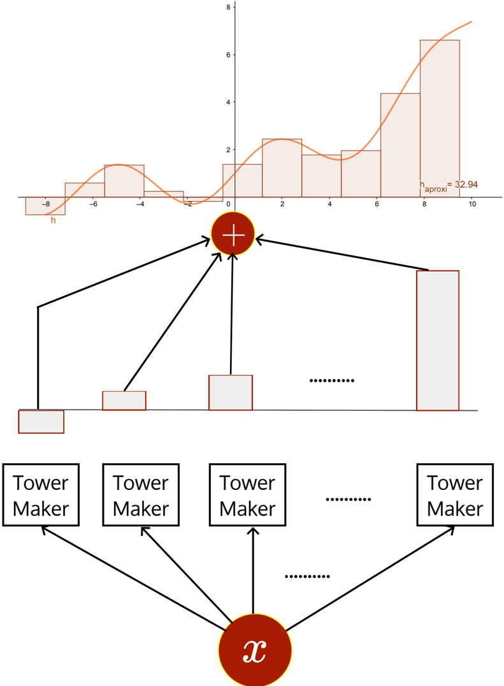

Any function can be represented by summing shifted and scaled versions of tower functions
Suppose there is a black box which takes the original input and constructs these tower functions ( x )
We can then have a simple network which can just add them up to approximate the function
Our job now is to figure out what is inside this blackbox

## We will figure this out over the next few slides ...

https://www.geogebra.org/material/iframe/id/xbef82sg/width/1200/height/500/border/888888/sfsb/true/sm b/false/stb/false/stbh/false/ai/false/asb/false/sri/false/rc/false/ld/false/sdz/true/ctl/false
If we take the logistic function and set to a very high value we will recover the step function w
Can we come up with a neural network to represent this operation of subtracting one sigmoid function from another ?

## What if we have more than one input?

https://www.geogebra.org/material/iframe/id/njtq7kxz/width/1200/height /700/border/888888/sfsb/true/smb/false/stb/false/stbh/false/ai/false/as b/false/sri/false/rc/false/ld/false/sdz/true/ctl/false
Suppose we are trying to take a decision about whether we will find oil at a particular location on the ocean bed (Yes/No)
Further, suppose we base our decision on two factors: Salinity and Pressure ( x 1 ) ( x 2 )
We are given some data and it seems that is a complex function of and y ∈ { oil , no oil } x 1 x 2
We want a neural network to approximate this function

https://www.geogebra.org/material/iframe/id/x8rauxn k/width/700/height/500/border/888888/sfsb/true/sm b/false/stb/false/stbh/false/ai/false/asb/false/sri/fals e/rc/false/ld/false/sdz/true/ctl/false
We need to figure out how to get a tower in this case
Let us vary the parameter keeping and . w 1 w 2 = 0 b = 0
Let us vary the parameter keeping and . w 2 w 1 = 0 b = 0
Let us vary the parameter   keeping and . b w 1 = k w 2 = 0
https://www.geogebra.org/material/iframe/id/gkv29xfn/width/1200/hei ght/750/border/888888/sfsb/true/smb/false/stb/false/stbh/false/ai/fal se/asb/false/sri/false/rc/false/ld/false/sdz/true/ctl/false

What if we take two such step functions (with different b values) and subtract one from the other
We still don't get a tower (or we get a tower which is open from two sides)
Can we come up with a neural network to represent this entire procedure of constructing a 3 dimensional tower ?

## Creating 2D Tower Function

https://www.geogebra.org/material/iframe/id/z8eahyrs/width/1024/height/600/border/888888/sfs b/true/smb/false/stb/false/stbh/false/ai/false/asb/false/sri/false/rc/false/ld/false/sdz/true/ctl/fals
e

## What if we have more than one input?

https://www.geogebra.org/material/iframe/id/njtq7kxz/width/1200/height /700/border/888888/sfsb/true/smb/false/stb/false/stbh/false/ai/false/as b/false/sri/false/rc/false/ld/false/sdz/true/ctl/false
Suppose we are trying to take a decision about whether we will find oil at a particular location on the ocean bed (Yes/No)
Further, suppose we base our decision on two factors: Salinity and Pressure ( x 1 ) ( x 2 )
We are given some data and it seems that is a complex function of and y ∈ { oil , no oil } x 1 x 2
We want a neural network to approximate this function

## Think

For 1 dimensional input we needed 2 neurons to construct a tower
For 2 dimensional input we needed 4 neurons to construct a tower
How many neurons will you need to construct a tower in n dimensions