## CS6910: Fundamentals of Deep Learning

## Lecture 4: Feedforward Neural Networks, Backpropagation

## Mitesh M. Khapra

AI4Bharat, Department of Computer Science and Engineering, IIT Madras

## References/Acknowledgments

See the excellent videos by Hugo Larochelle on Backpropagation and Andrej Karpathy Lecture (CS231n Winter 2016) on Bckpropagation, Neural Networks
Module 4.1: Feedforward Neural Networks (a.k.a. multilayered network of neurons)
Mitesh M. Khapra

AI4Bharat, Department of Computer Science and Engineering, IIT Madras

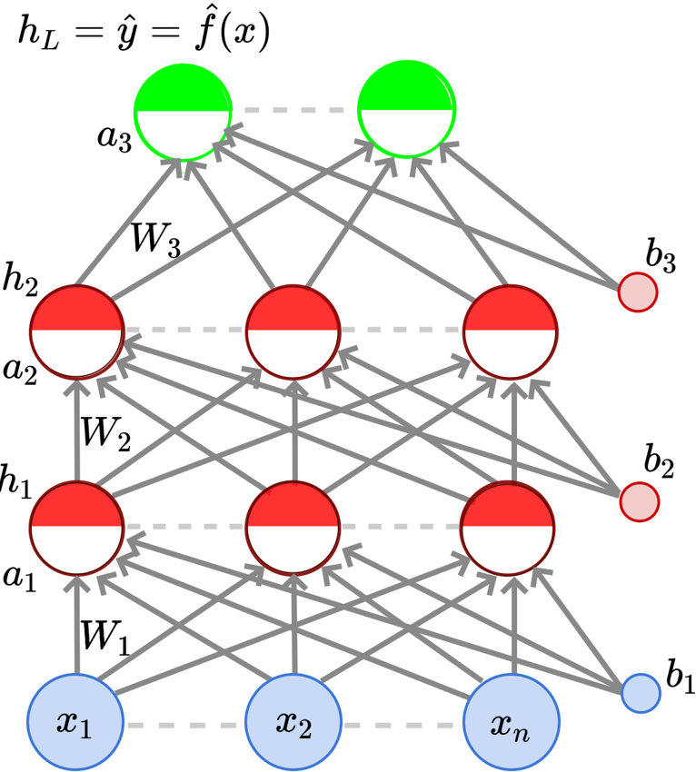

The input to the network is an -dimensional vector n
The network contains hidden layers (2, in this case) having neurons each L-1 n
Finally, there is one output layer containing neurons (say, corresponding to classes) k k and activation and are vectors) a i h i Each neuron in the hidden layer and output layer can be split into two parts : pre-activation and activation ( and are vectors) a i h i pre-activation ( and are vectors) a i h i
The input layer can be called the -th layer and the output layer can be called the ( )-th layer 0 L
and are the weight and bias between layers and ) W ∈ i R n × n b ∈ i R n i -1 i (0 < i < L
and are the weight and bias between the last hidden layer and the output layer   ( ) in this case) W ∈ L R k × n b ∈ L R k L = 3

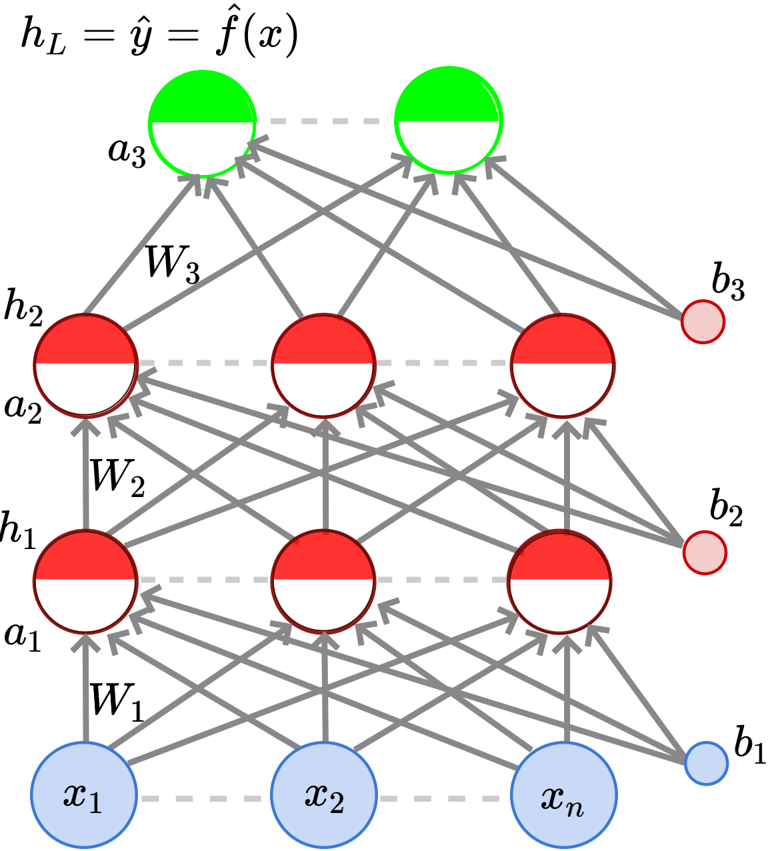

The pre-activation at layer   is given by i

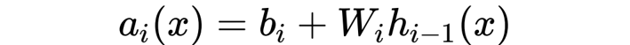

The activation at layer   is given by i

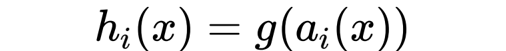

where is called the activation function (for example, logistic, tanh, linear, etc.) g
The activation at the output layer is given by

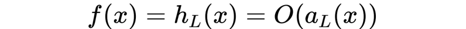

where is the output activation function (for example, softmax, linear, etc.) O
To simplify notation we will refer to as and as a ( x ) i a i h ( x ) i h i

The pre-activation at layer   is given by i

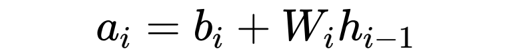

The activation at layer   is given by i

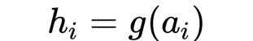

where is called the activation function (for example, logistic, tanh, linear, etc.) g
The activation at the output layer is given by

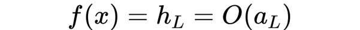

where is the output activation function (for example, softmax, linear, etc.) O

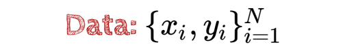

## Model:

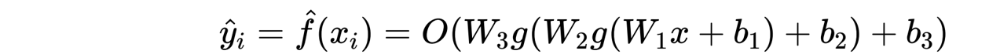

## Parameters:

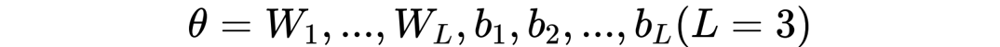

Algorithm: Gradient Descent with Backpropagation (we will see soon)
Objective/Loss/Error function: Say,

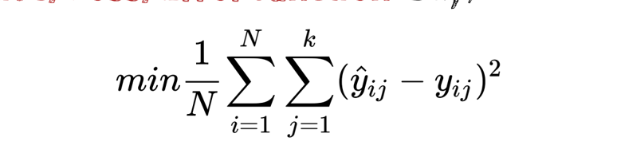

In general, min L ( θ )
where is some function of the parameters L ( θ )
Module 4.2: Learning Parameters of Feedforward Neural Networks (Intuition)
Mitesh M. Khapra

AI4Bharat, Department of Computer Science and Engineering, IIT Madras

## The story so far...

We have introduced feedforward neural networks
We are now interested in finding an algorithm for learning the parameters of this model

## Recall our gradient descent algorithm We can write it more concisely as

## Algorithm: gradient_descent()

w ← t +1 w -t η ∇ wt b ← t +1 b -t η ∇ b t t ←0; max _ iterations ←1000; end while ++ do t < max _ iterations Initialize w , b ; 0 0

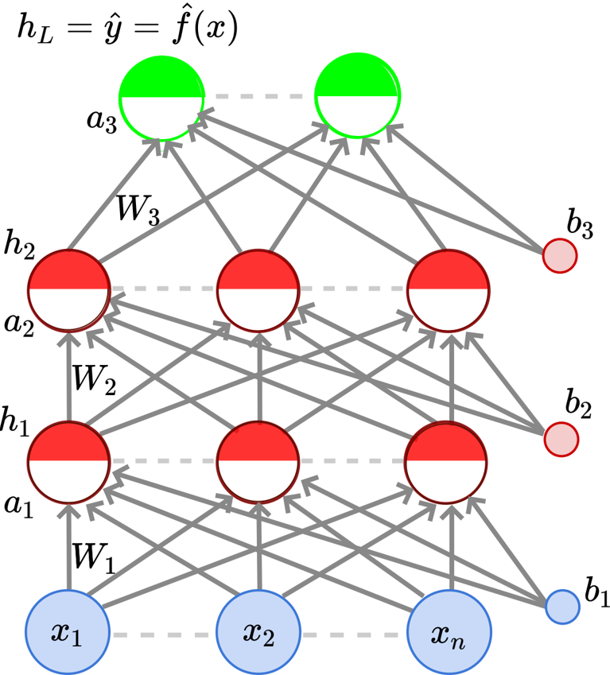

## Recall our gradient descent algorithm We can write it more concisely as

## Algorithm: gradient_descent()

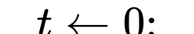

max _ iterations ←1000;
Initialize
θ
0 = [
w
,
b
];
0
0
while ++ do t < max _ iterations

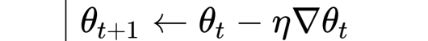

## end

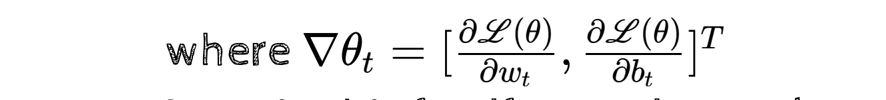

Now, in this feedforward neural network, instead of we have θ = [ w , b ] θ =

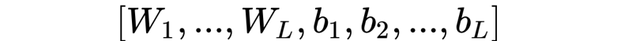

We can still use the same algorithm for learning the parameters of our model

## Recall our gradient descent algorithm We can write it more concisely as

## Algorithm: gradient_descent()

t ←0; max _ iterations ←1000; Initialize θ 0 = [ W , ..., W , b , ..., b ]; 1 0 L 0 1 0 L 0 end while ++ do t < max _ iterations θ ← t +1 θ -t η ∇ θ t
Now, in this feedforward neural network, instead of we have θ = [ w , b ] θ = [ W , ..., W , b , b , ..., b ] 1 L 1 2 L where ∇ θ = t [ , ., , , ., ] ∂ W 1, t ∂ L ( θ ) ∂ WL , t ∂ L ( θ ) ∂ b 1, t ∂ L ( θ ) ∂ b L , t ∂ L ( θ ) T
We can still use the same algorithm for learning the parameters of our model 12
⎡

## Except that now our looks much more nasty ∇ θ

| ∂ W 111 ∂ L ( θ )   | ...   | ∂ W 11 n ∂ L ( θ )   | ∂ W 211 ∂ L ( θ )   | ...   | ∂ W 21 n ∂ L ( θ )   | ∂ W L ,11 ∂ L ( θ )   | ∂ W L ,1 k ∂ L ( θ )   | ∂ b 11 ∂ L ( θ )   | ∂ b L 1 ∂ L ( θ )   |
|---------------------|-------|----------------------|---------------------|-------|----------------------|-----------------------|------------------------|--------------------|---------------------|
| ∂ L ( θ )           | ...   | ∂ W 11 n ∂ L ( θ )   | ∂ W 211 ∂ L ( θ )   | ...   | ∂ L ( θ )            | ∂ L ( θ )             | ∂ L ( θ )              | L ( θ              | L (                 |
|                     | ...   | ∂ L ( θ )            | ∂ L ( θ )           | ...   | ∂ W 21 n ∂ L ( θ )   | ∂ W L ,11 ∂ L ( θ )   | ∂ W L ,1 k ∂ L ( θ )   | ∂ b 11 ∂ L ( θ )   | ∂ b L 1 ∂ L ( θ )   |
| ∂ W 121             |       | ∂ W 12 n             | ∂ W 221             | ...   | ∂ W 22 n             | ∂ W L ,21             | ∂ W L ,2 k             | ∂ b 12             | b L                 |
| ⋮                   | ⋮     | ⋮                    | ⋮                   | ⋮     | ⋮                    | ⋮                     | ⋮                      | ⋮                  | ⋮                   |
|                     |       |                      |                     |       |                      |                       | ∂ W L , nk             | ∂ b 1 n            | b Lk                |
| ∂ L ( θ )           | ...   | ∂ L ( θ )            | ∂ L ( θ )           | ...   | ∂ L ( θ )            | ∂ L ( θ )             | ∂ L ( θ )              | ∂ L ( θ )          | ∂ L ( θ )           |
| ∂ W 1 n 1           |       | ∂ W 1 nn             | ∂ W 2 n 1           |       | ∂ W 2 nn             | ∂ W L , n 1           |                        |                    | ∂ L ( θ )           |

> 📊 [Table 1 CSV](artifacts/tables/table_1.csv) | [Table 1 HTML](artifacts/tables/table_1.html)

is thus composed of ∇ θ

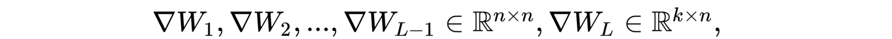

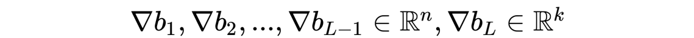

⎤

## We need to answer two questions

How to choose the loss function L ( θ )?
How to compute which is composed of ∇ θ
∇ W , ∇ W , ..., ∇ W ∈ 1 2 L -1 R , ∇ W ∈ n × n L R , k × n
b
∇
b
, ∇
b
, ..., ∇
∈
n
R
b
, ∇
∈
k
R
?
1
2
L
-1
L

## Module 4.3: Output Functions and Loss Functions

Mitesh M. Khapra

AI4Bharat, Department of Computer Science and Engineering, IIT Madras

## We need to answer two questions

How to choose the loss function L ( θ )?
How to compute which is composed of ∇ θ
∇ W , ∇ W , ..., ∇ W ∈ 1 2 L -1 R , ∇ W ∈ n × n L R k × n
∇ b , ∇ b , ..., ∇ b ∈ 1 2 L -1 R , ∇ b ∈ n L R k
, ?

## We need to answer two questions

How to choose the loss function L ( θ )?
How to compute which is composed of ∇ θ
∇ W , ∇ W , ..., ∇ W ∈ 1 2 L -1 R , ∇ W ∈ n × n L R k × n
∇ b , ∇ b , ..., ∇ b ∈ 1 2 L -1 R , ∇ b ∈ n L R k
, ?
isActor
Damon
isDirector
Nolan
.  .
.   .   .   .   .   .

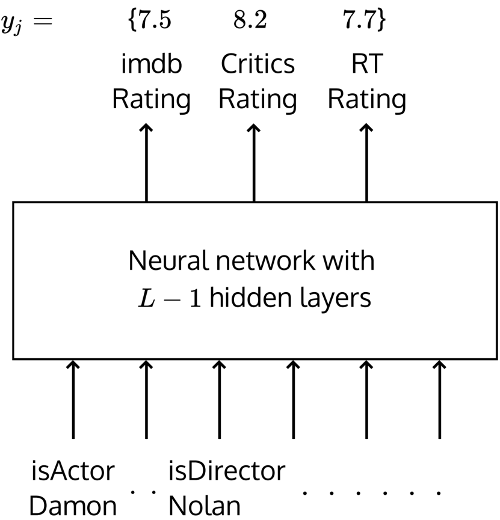

The choice of loss function depends on the problem at hand
We will illustrate this with the help of two examples
Consider our movie example again but this time we are interested in predicting ratings
Here y ∈ j R 3
The loss function should capture how much deviates from y ^ j y j
If then the squared error loss can capture this deviation y ∈ j R k

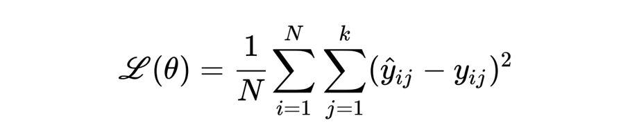

A related question: What should the output function ' ' be if ? O y ∈ j R
More specifically, can it be the logistic function?
No, because it restricts to a value between & but we want y ^ j 0 1 ∈ y ^ j R
So, in such cases it makes sense to have ' ' as linear function O

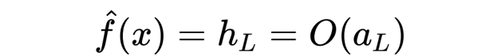

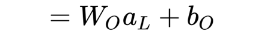

is no longer bounded between and = y ^ j ( X ) f ^ i 0 1
Watch this lecture on Information and Entropy here

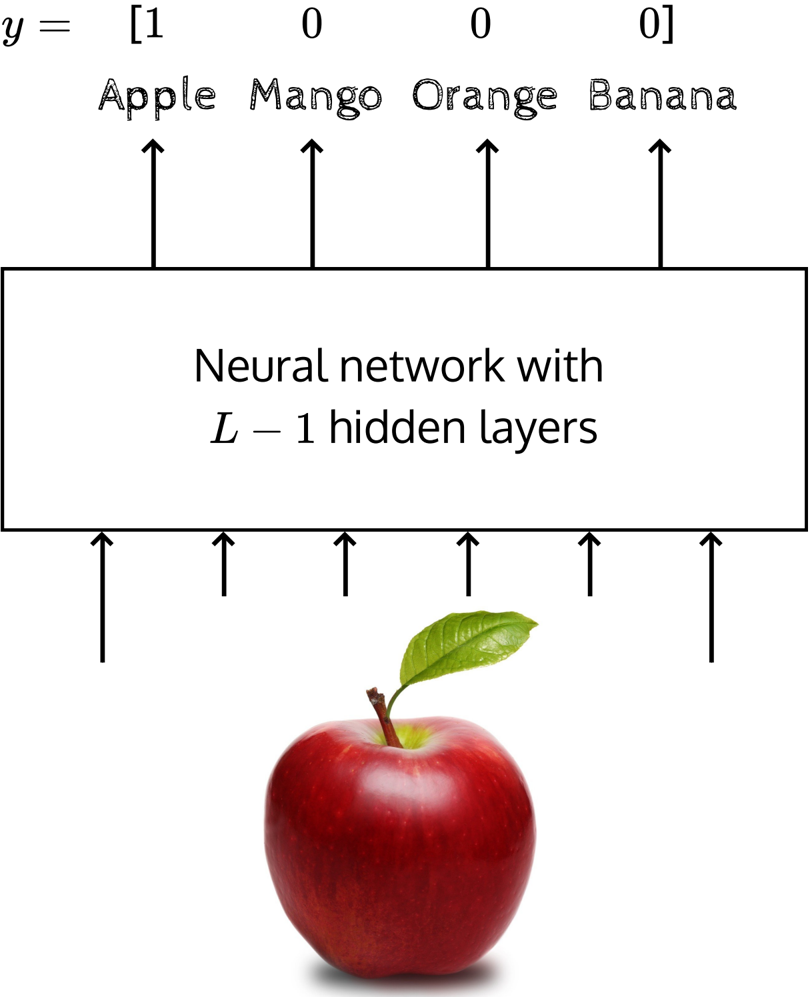

Now let us consider another problem for which a different loss function would be appropriate
Suppose we want to classify an image into 1 of classes k
Here again we could use the squared error loss to capture the deviation
But can you think of a better function?

Notice that is a probability distribution y
Therefore we should also ensure that is a probability distribution y ^
1
1

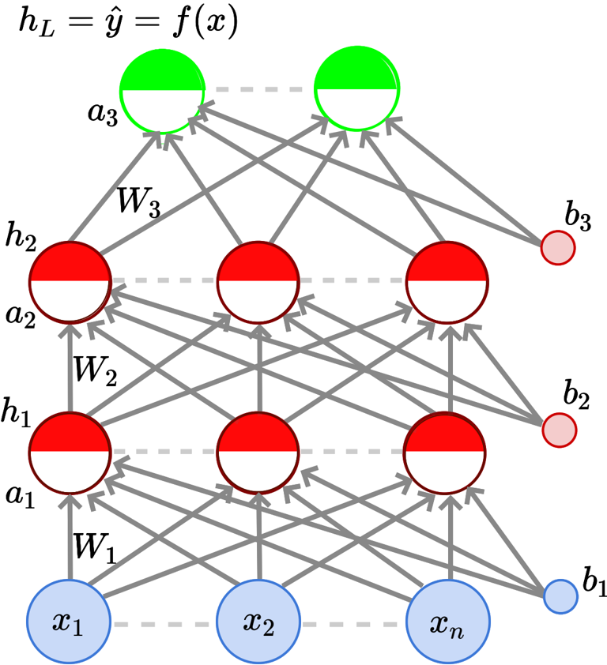

Notice that is a probability distribution y
Therefore we should also ensure that is a probability distribution y ^
What choice of the output activation ' ' will ensure this ? O

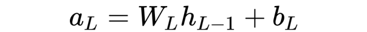

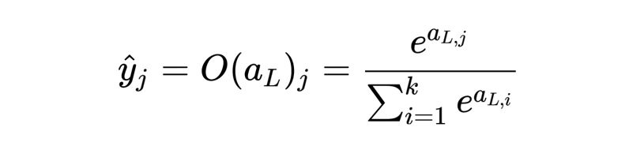

is the element of and is the element of the vector . O ( a ) L j j th y ^ a L , j j th a L
This function is called the function softmax

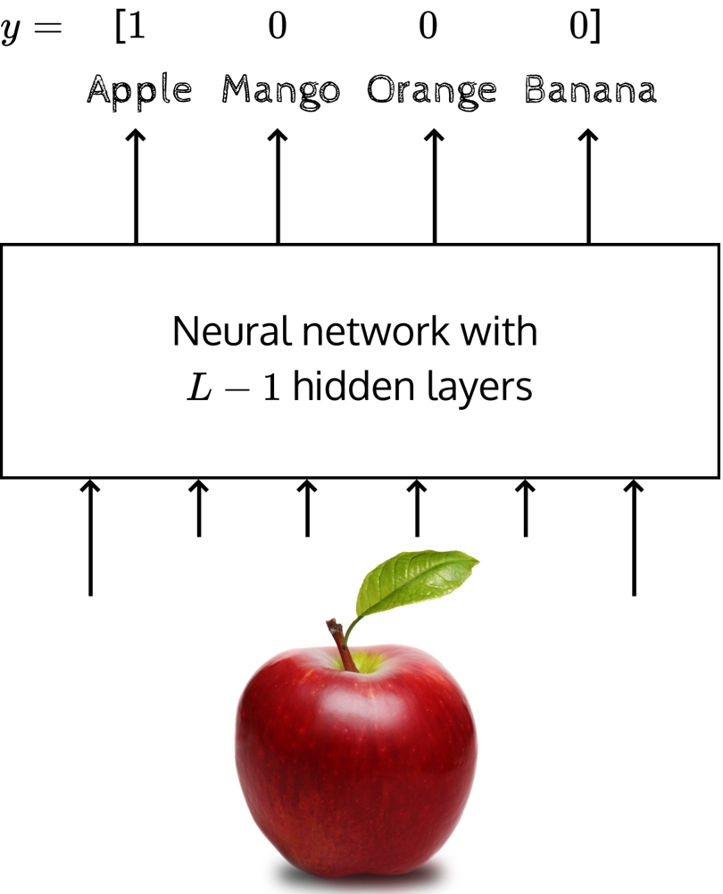

Now that we have ensured that both & are probability distributions can you think of a function which captures the difference between them? y y ^
Cross-entropy

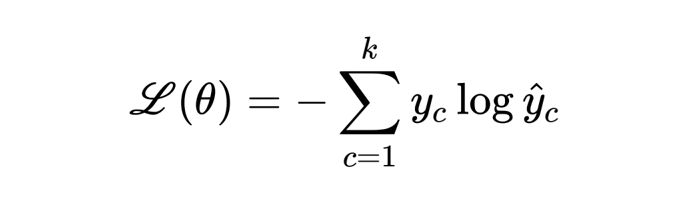

Notice that
(the true class label) y = c 1  if c = ℓ
= 0  otherwise

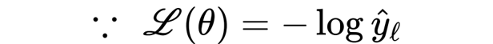

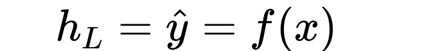

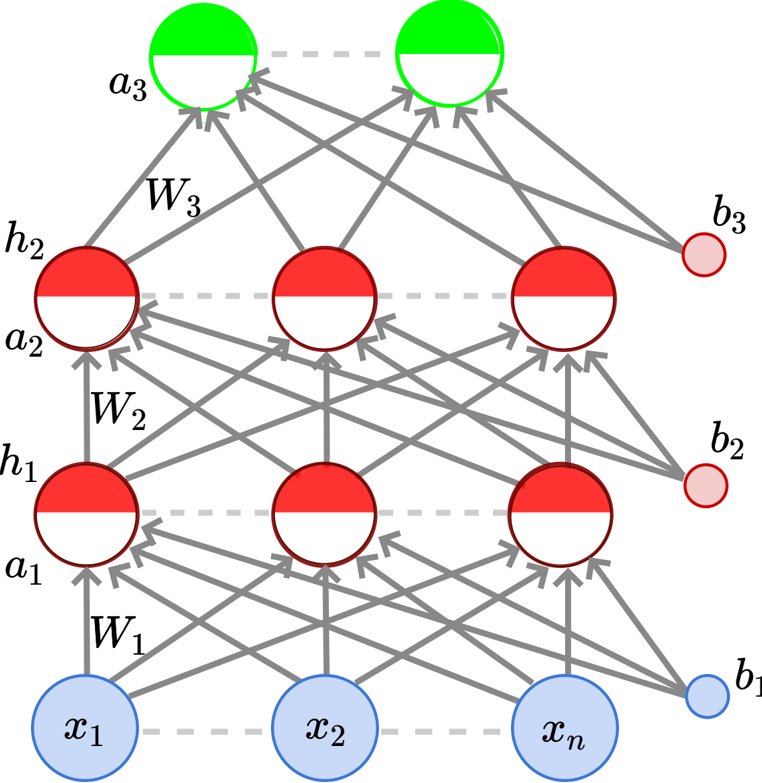

1
So, for classification problem (where you have to choose of classes), we use the following objective function 1 K

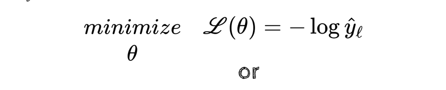

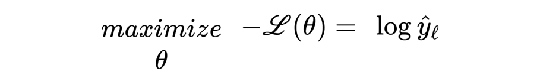

## But wait!

Is a function of y ^ ℓ θ = [ W , W , ., W , b , b , ., b ]? 1 2 L 1 2 L
Yes, it is indeed a function of θ

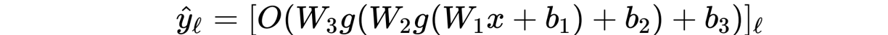

What does encode? y ^ ℓ
It is the probability that belongs to the class (bring it as close to ). x ℓ th 1
is called the of the data. log y ^ ℓ log -likelihood

|                   | Outputs       | Outputs       |
|-------------------|---------------|---------------|
|                   | Real Values   | Probabilities |
| Output Activation | Linear        | Softmax       |
| Loss Function     | Squared Error | Cross Entropy |

> 📊 [Table 2 CSV](artifacts/tables/table_2.csv) | [Table 2 HTML](artifacts/tables/table_2.html)

Of course, there could be other loss functions depending on the problem at hand but the two loss functions that we just saw are encountered very often

|                   | Outputs       | Outputs       |
|-------------------|---------------|---------------|
|                   | Real Values   | Probabilities |
| Output Activation | Linear        | Softmax       |
| Loss Function     | Squared Error | Cross Entropy |

> 📊 [Table 3 CSV](artifacts/tables/table_3.csv) | [Table 3 HTML](artifacts/tables/table_3.html)

Of course, there could be other loss functions depending on the problem at hand but the two loss functions that we just saw are encountered very often
For the rest of this lecture we will focus on the case where the output activation is a softmax function and the loss function is cross entropy

## Module 4.4: Backpropagation (Intuition)

Mitesh M. Khapra

AI4Bharat, Department of Computer Science and Engineering, IIT Madras

## We need to answer two questions

How to choose the loss function L ( θ )?
How to compute which is composed of ∇ θ
∇ W , ∇ W , ..., ∇ W ∈ 1 2 L -1 R , ∇ W ∈ n × n L R , n × k ∇ b , ∇ b , ..., ∇ b ∈ 1 2 L -1 R , ∇ b ∈ n L R ? k
Let us focus on this one weight ( ). W 112
To learn this weight using SGD we need a formula for . ∂ W 112 ∂ L ( θ )
We will see how to calculate this.

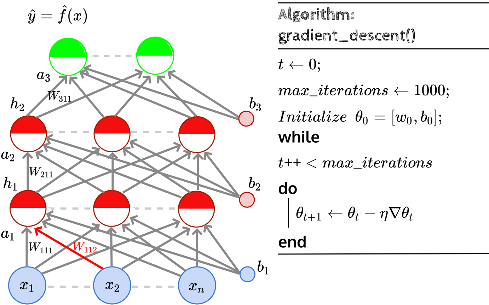

First let us take the simple case when we have a deep but thin network.
In this case it is easy to find the derivative by chain rule.

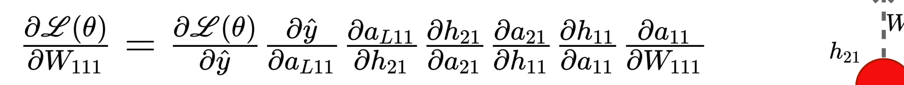

x

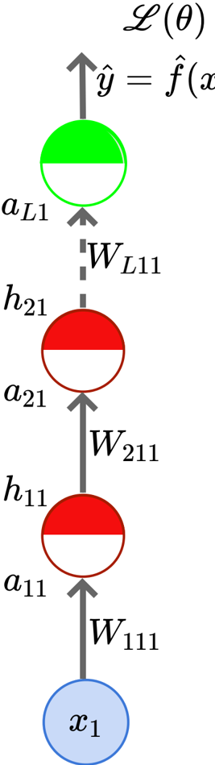

)
First let us take the simple case when we have a deep but thin network.
In this case it is easy to find the derivative by chain rule.

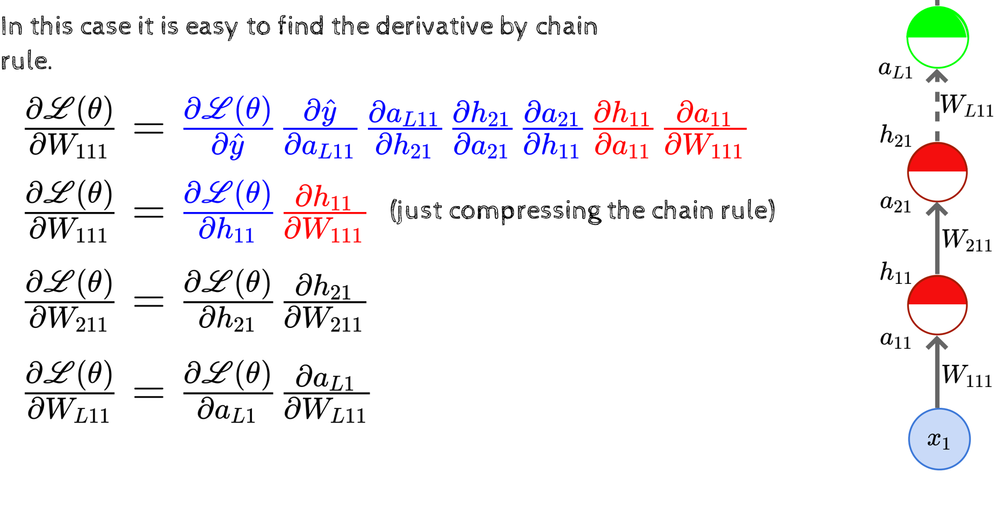

x

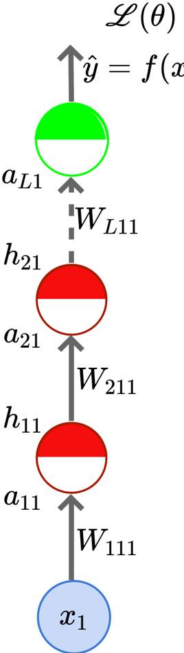

)
Let us see an intuitive explanation of backpropagation before we get into the mathematical details
We get a certain loss at the output and we try to figure out who is responsible for this loss

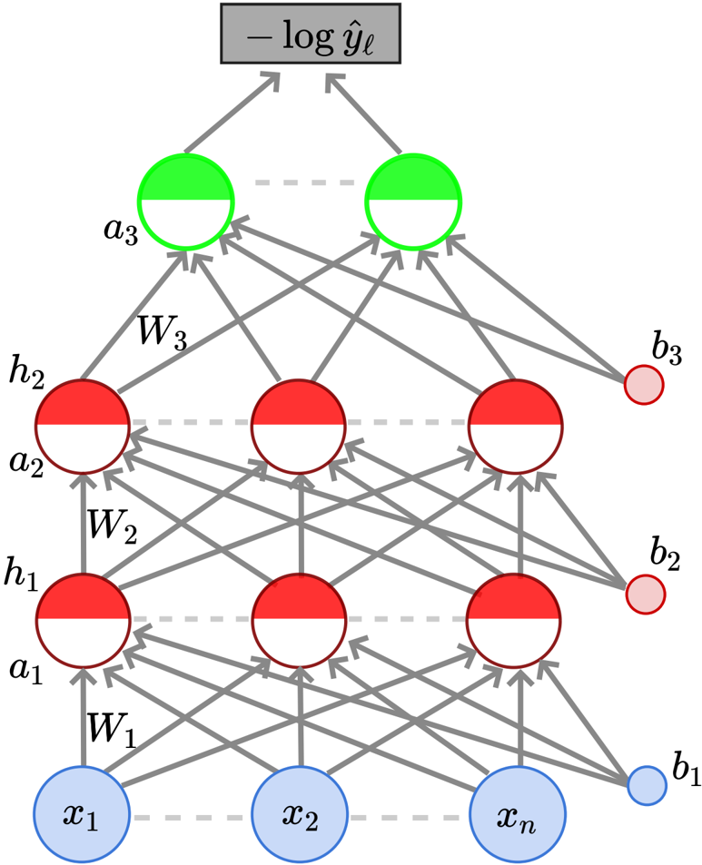

- We  get  a  certain  loss  at  the  output  and  we  try  to figure out who is responsible for this loss
- So, we talk to the output layer and say "Hey! You are not producing the desired output, better take responsibility".

We get a certain loss at the output and we try to figure out who is responsible for this loss
So, we talk to the output layer and say "Hey! You are not producing the desired output, better take responsibility".
The output layer says "Well, I take responsibility for my part but please understand that I am only as good as the hidden layer and weights below me". After all.

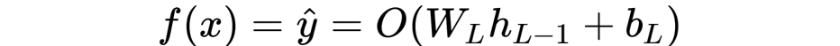

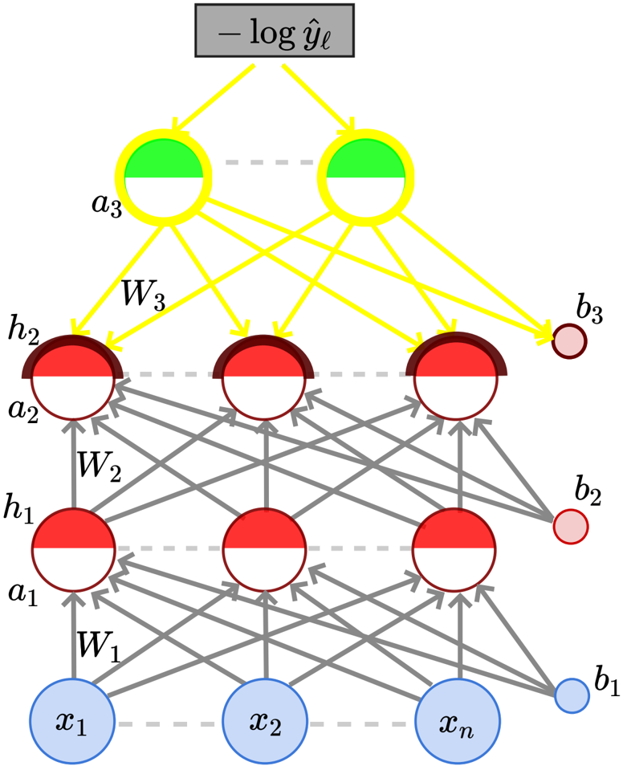

So, we talk to and and ask them "What is wrong with you?" W , b L L h L
1

- So, we talk to and and ask them "What is wrong with you?" W , b L L h L
and take full responsibility but says "Well, please understand that I am only as good as the preactivation layer" WL b L h L

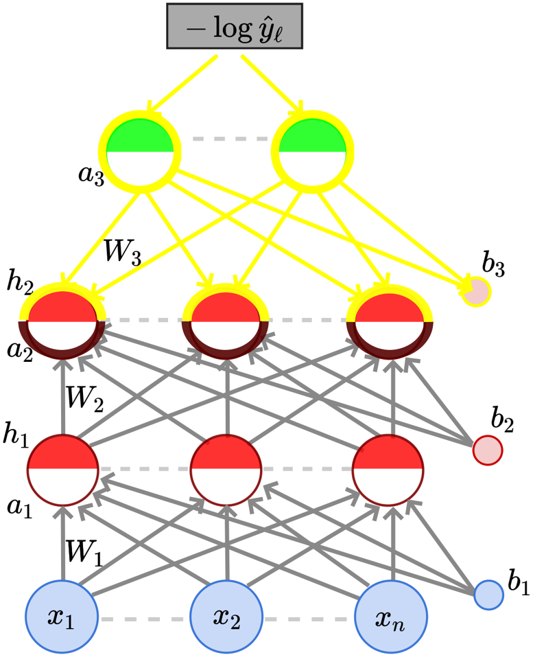

- So, we talk to and and ask them "What is wrong with you?" W , b L L h L
- and take full responsibility but says "Well, please understand that I am only as good as the preactivation layer" WL b L h L
- The pre-activation layer in turn says that I am only as good as the hidden layer and weights below me.

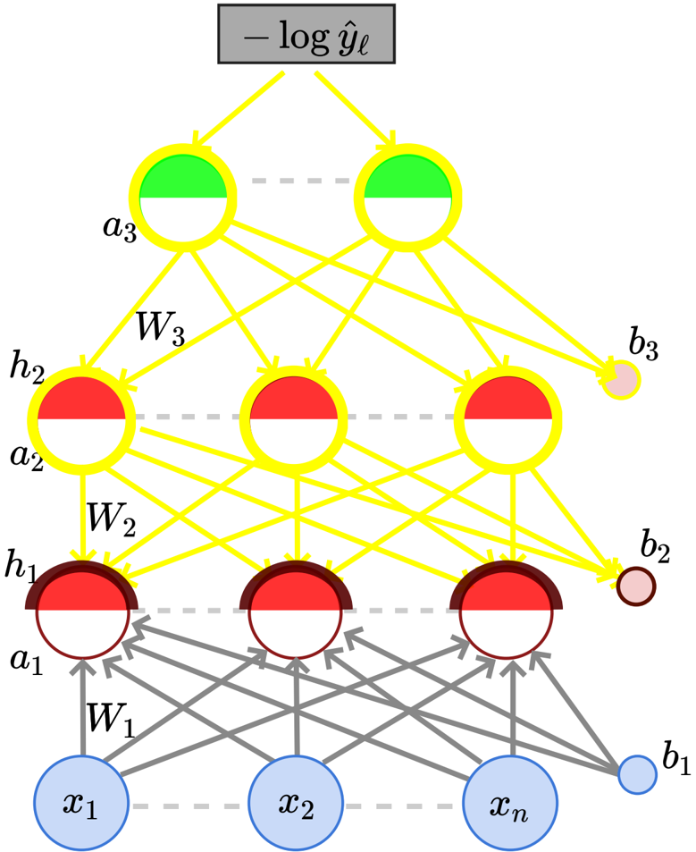

- So, we talk to and and ask them "What is wrong with you?" W , b L L h L
- and take full responsibility but says "Well, please understand that I am only as good as the preactivation layer" WL b L h L
- The pre-activation layer in turn says that I am only as good as the hidden layer and weights below me.
- We continue in this manner and realize that the responsibility lies with all the weights and biases (i.e. all the parameters of the model)

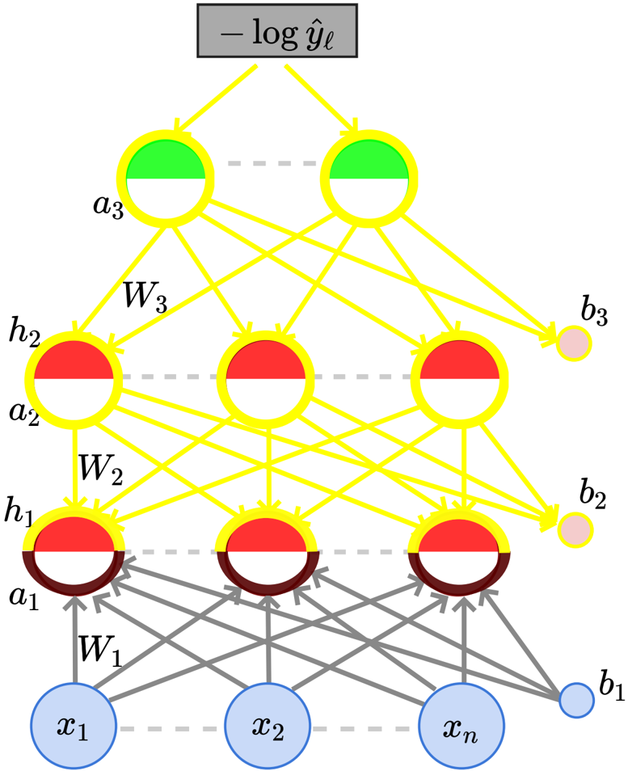

So, we talk to and and ask them "What is wrong with you?" W , b L L h L
and take full responsibility but says "Well, please understand that I am only as good as the preactivation layer" WL b L h L
The pre-activation layer in turn says that I am only as good as the hidden layer and weights below me.
We continue in this manner and realize that the responsibility lies with all the weights and biases (i.e. all the parameters of the model)
But instead of talking to them directly, it is easier to talk to them through the hidden layers and output layers (and this is exactly what the chain rule allows us to do)

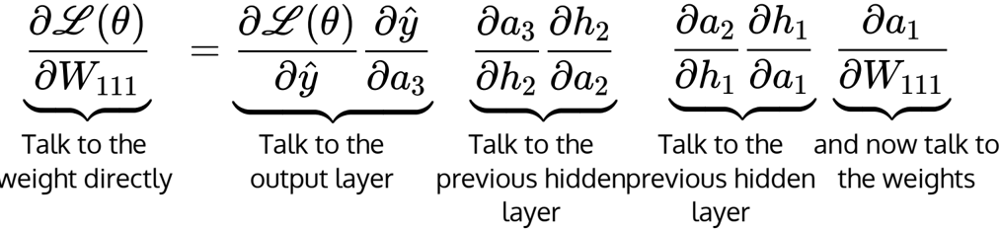

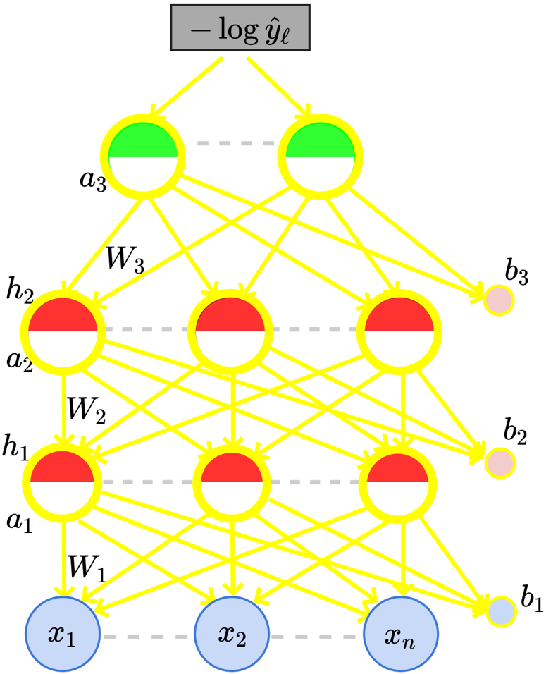

## Quantities of interest (roadmap for the remaining part):

Gradient w.r.t. output units
Gradient w.r.t. hidden units
Gradient w.r.t. weights and biases

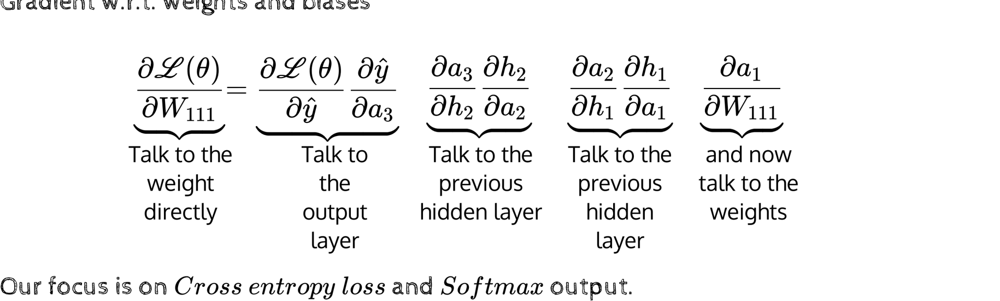

Our focus is on and output. Cross entropy loss Softmax

## Module 4.5: Backpropagation: Computing Gradients w.r.t. the Output Units

Mitesh M. Khapra

AI4Bharat, Department of Computer Science and Engineering, IIT Madras
Quantities of interest (roadmap for the remaining part):
Gradient w.r.t. output units
Gradient w.r.t. hidden units
Gradient w.r.t. weights and biases

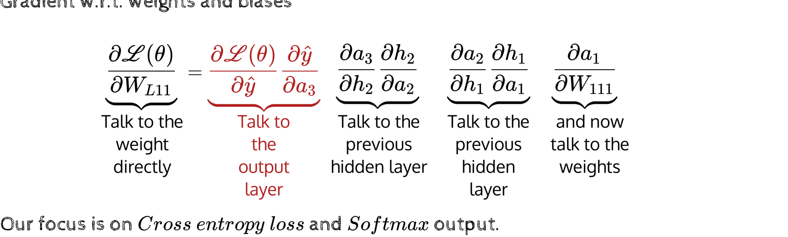

Our focus is on and output. Cross entropy loss Softmax
Let us first consider the partial derivative w.r.t.  -th output i

More Compactly,

1

We can now talk about the gradient w.r.t. the vector y ^

⎤

where is a k-dimensional vector e (ℓ)
whose  -th element is and all other elements are . l 1 0

## What we are actually interested in is

Does depend on y ^ ℓ a ? Li Indeed, it does.

Having established this, we will now derive the full expression on the next slide

So far we have derived the partial  derivative w.r.t.
the  -th element of i a L

We can now write the gradient w.r.t. the vector a L

1

## Module 4.6: Backpropagation: Computing Gradients w.r.t. Hidden Units

Mitesh M. Khapra

AI4Bharat, Department of Computer Science and Engineering, IIT Madras

## Quantities of interest (roadmap for the remaining part):

Gradient w.r.t. output units
Gradient w.r.t. hidden units
Gradient w.r.t. weights and biases

∂ h 2 ∂ a 3 ∂ a 2 ∂ h 2 Talk to the previous hidden layer
∂ h 1 ∂ a 2 ∂ a 1 ∂ h 1 Talk to the previous hidden layer
Our focus is on and output. Cross entropy loss Softmax
∂ W 111 ∂ a 1 and now talk to the weights
Chain rule along multiple paths: If a function can be written as a function of intermediate results then we have : p ( z ) q ( z ) i

In our case:
is the loss function p ( z ) L ( θ )

1

Now consider these two vectors,

is the -th column of W = i +1, ⋅ , j j W ; i +1 see that,

We can now write the gradient w.r.t. h i

We are almost done except that we do not know how to calculate for ∇ a L ( θ ) i +1 i < L -1
We will see how to compute that

## Module 4.7: Backpropagation: Computing Gradients w.r.t. Parameters

Mitesh M. Khapra

AI4Bharat, Department of Computer Science and Engineering, IIT Madras

## Quantities of interest (roadmap for the remaining part):

Gradient w.r.t. output units
Gradient w.r.t. hidden units

## Gradient w.r.t. weights and biases

∂ h 1 ∂ a 2 ∂ a 1 ∂ h 1 Talk to the previous hidden layer
Our focus is on and output. Cross entropy loss Softmax
∂ W 111 ∂ a 1 and now talk to the weights
Recall that,
1

Lets take a simple example of a W ∈ k R 3×3
and see what each entry looks like

Lets take a simple example of a W ∈ k R 3×3
and see what each entry looks like

Lets take a simple example of a W ∈ k R 3×3
and see what each entry looks like

Lets take a simple example of a W ∈ k R 3×3
and see what each entry looks like

Lets take a simple example of a W ∈ k R 3×3
and see what each entry looks like

Finally, coming to the biases

We can now write the gradient w.r.t. the vector b k

## Module 4.8: Backpropagation: Pseudo code

Mitesh M. Khapra

AI4Bharat, Department of Computer Science and Engineering, IIT Madras
Finally, we have all the pieces of the puzzle

∇ L ( θ ), ∇ L ( θ ) h k a k (gradient w.r.t. hidden layers, ) 1 ≤ k < L
∇ L ( θ ), ∇ L ( θ ) Wk b k (gradient w.r.t. weights and biases, 1 ≤ k < L
We can now write the full learning algorithm

## Algorithm: gradient_descent()

t ←0; max _ iterations ←1000; Initialize θ 0 = [ W , ..., W , b , ..., b ]; 1 0 L 0 1 0 L 0 end while ++ do t < max _ iterations θ ← t +1 θ -t η ∇ θ t _ a , h , a , h , ..., a , h , a , = 1 1 2 2 L -1 L -1 L y ^ forward propagation ( θ ) t _ ∇ θ = t backward propagation ( h , h , ..., h , a , a , ..., a , y , 1 2 L -1 1 2 L y ^
)

## Algorithm: forward_propagation( ) θ

a
=
k
b
+
k
W h
h
k

## end

=
g
a
(
k
k
k
)
-1
;
Just do a forward propagation and compute all s, s, and h ' i a ' i y ^
Algorithm: back_propagation( ) h , h , ..., h , a , a , ..., a , y , 1 2 L -1 1 2 L y ^ end for to do k = L 1 ∇ L ( θ ) = a L -( e ( y ) -); y ^ // Compute output gradient ; // Compute gradients w.r.t. parameters ; ∇ L ( θ ) = Wk ∇ L ( θ ) h ; a k k -1 T ∇ L ( θ ) = b k ∇ L ( θ ); a k // Compute gradients w.r.t. layer below ; ∇ L ( θ ) = h k -1 W ∇ L ( θ ); k T a k // Compute gradients w.r.t. layer below (pre-activation) ; ∇ L ( θ ) = a k -1 ∇ L ( θ ) ⊙ h k -1 [..., g ( a ), ...]; ′ k -1, j

## Module 4.9: Derivative of the activation function

## Mitesh M. Khapra

AI4Bharat, Department of Computer Science and Engineering, IIT Madras
Now, the only thing we need to figure out is how to compute g ′

## Logistic function

## tanh function

