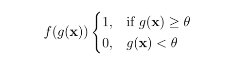
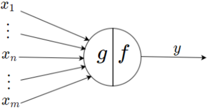
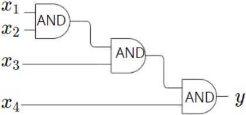
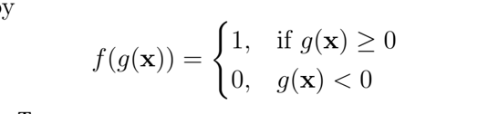
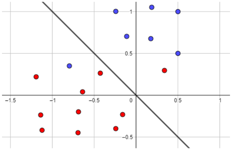
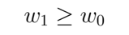
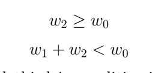
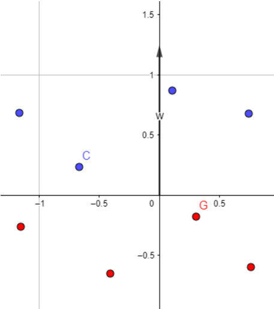

## Fundamentals of Deep Learning

## Prof.Mitesh M.Khapra Mr.A Arun Prakash

Week-1 Graded Assignment
1. (1 point) (Multiple select) Which of the following threshold values of MP neuron implements AND Boolean function? Assume that the number of inputs to the neuron is 10 and the neuron does not have any inhibitory inputs.
1. 1
1. 10
C. 11
1. 12

## Answer: B

## Solution:

10 ∑ i =1 x i ≥ 10 does not imply that setting θ ≥ 10 implements AND function. Suppose, we set θ = 11, then summing all the input never exceeds 11, therefore, the neuron won't fire.
1. (1 point) The diagram below shows an MP neuron.
Suppose that we define the function g as follows,

.The output from the neuron is given by,

X 1
:
Хт
f

How many inputs are inhibitory in the neuron? Assume θ is positive valued.
1. 0
1. m
1. n
1. m-n
1. m-n+1

## Answer: D

## Solution:

Note that if any of the inputs from n +1 to m is set to 1, then the product becomes zero. Therefore, the output will become zero despite the other inputs.
X1
X2-
AND
AND
1. (1 point) The diagram below shows an implementation of a Boolean function using three logical AND gates. What is the minimum number of MP neurons required to implement the same Boolean function? Assume that all inputs are excitatory.
1. 3
1. 2
1. 1
1. 4

## Answer: C

## Solution:

A single neuron can implement this logic function with the threshold value set to 3 ( θ = 3)
1. (1 point) We know that a Boolean function maps { 0 , 1 } n →{ 0 , 1 } . How many Boolean functions are there when n = 0?
1. 0
1. 1
1. 2
1. 4

## Answer: C

## Solution:

First by Formula, 2 2 n , returns 2 when n = 0. However, For n = 0, the input set is empty. Nevertheless, the function maps it to either 0 or 1
-1.5
0.5
1. (1 point) An input to the perceptron model is, x = [ x 0 , x 1 , · · · , x n ] T and the weight vector is w = [ w 0 , w 1 , · · · , w n ] T . The output from the perceptron is given by
-0.5

where g ( x ) = w T x , then the decision boundary (i.e, the hyper-plane that separates the data points) passes through the origin in?
1. n th dimension
1. ( n +1) th dimension
1. ( n -1) th dimension
1. It is not possible to decide whether it passes through the origin in any of the dimension

## Answer: B

## Solution:

Recall that, if we consider n dimensional input, then g ( x ) = w T x ≥ w 0 . Therefore, in nth dimension, the decision boundary is a hyperplane with an intercept term w 0 . However, when we rewrite the equation in n +1 th dimension, then g ( x ) = w T x ≥ 0 is a hyperplane passing through the origin.
1. (1 point) In the diagram shown below, the blue data points belong to positive class ( w T x ≥ 0) and red data points belong to negative class ( w T x < 0). The number of misclassified data points according to the decision line as shown in the figure is?

·
1. 0
1. 1
1. 2
1. Insufficient information

## Answer:

## Solution:

Well, without the equation of line, it is not possible to conclude whether the given points are correctly classified or not. The weight vector corresponding to this line could be either w = [1 , 1] T or w = [ -1 , -1] T . Therefore, the results differ.
1. (1 point) The table below shows the truth table for NAND gate (a Boolean function). Suppose that the perceptron model is to be used for learning the decision line such that it separates all the data points with zero classification error

|   x 1 |   x 2 |   y |
|-------|-------|-----|
|     0 |     0 |   1 |
|     1 |     0 |   1 |
|     0 |     1 |   1 |
|     1 |     1 |   0 |

> 📊 [Table 1 CSV](artifacts/tables/table_1.csv) | [Table 1 HTML](artifacts/tables/table_1.html)

The value of the bias term ( w 0 ) should strictly be
1. Positive
1. Non-negative
1. negative
1. Depends on the other weight( w 1 , w 2 ) values

## Answer:

C

## Solution:

Writing the inequalities for all the input pairs,

D

Note that the second and third inequalities imply that the w 1 and w 2 should be greater than w 0 but the third inequality put a constraint that their sum must be less than w 0 .Therefore, w 0 ∈ R -
C
·
1.5
Common data for question 8,9 and 10
In the figure shown below, the blue points belong to class 1 (positive class) and the red points belong to class 0 (negative class). Suppose that we use a perceptron model, with the weight vector w as shown in the figure, to separate these data points. We define the point belongs to class 1 if w T x ≥ 0 else it belongs to class 0.
-0.5 -

1. (1 point) The point G and C will be classified as?
Note: the notation ( G, 0) denotes the point G will be classified as class-0 and ( C, 1) denotes the point C will be classified as class-1

1. ( G, 1) , ( C, 0)
1. ( G, 0) , ( C, 1)
1. ( G, 1) , ( C, 1)

## Answer:

B

## Solution:

Note that the weight vector W is pointing in the positive y direction, so we know that w = [ 0 y ] . Recall that the decision line (a line that separates
all the data points) is always perpendicular to the weight vector W . So, the decision line is the horizontal x -axis.
Noting that the y coordinates of blue points are all positive and red points are all negative, we can conclude that the point G will be classified as class-1 and the point C will be classified as class-0.
1. (1 point) The statement that 'there exists more than one decision lines that could separate these data points with zero error ' is,
1. True
1. False

## Answer: A

1. (1 point) Suppose that we multiply the weight vector w by -1 . Then the same points G and C will be classified as?

1. ( G, 1) , ( C, 0)
1. ( G, 0) , ( C, 1)
1. ( G, 1) , ( C, 1)

## Answer: C

## Solution:

Follow the similar arguments put forth for question 8.